# Abstract

In much of sub-Saharan Africa, getting a medicine is a search problem before it is a clinical one. A patient with malaria symptoms in Lagos typically walks or takes a bus to the nearest patent medicine vendor or community pharmacy, often the shop they always use, without knowing whether it has the drug, what it will cost, or whether it is open. When the shop is out of stock the patient travels again, delays treatment, or buys whatever is available, sometimes from an unverified seller. The facility network itself is not the only gap; the information about it is invisible. Stock levels, prices and opening hours exist only inside each shop.

This report is motivated by that information gap. It presents the design and implementation of an **Access Point Digital Twin (APDT)**: a continuously synchronised virtual representation of each point where a patient can obtain care or medicines (a pharmacy, a patent and proprietary medicine vendor, or a clinic dispensary). It covers the access point's location, opening hours, live stock, prices and recent demand. The APDT is **co-developed with an Adaptive Human Digital Twin (AHDT)**, a virtual representation of the patient's current context: location, need, preferred access point, order history and conversation memory. It adapts as the patient interacts. Agentic AI connects the two twins. Large language model (LLM) agents call typed tools over the twins to search, compare prices, and reroute a request when the preferred access point is out of stock. They place orders only after explicit confirmation, and every order is sealed with a tamper-evident SHA-256 hash.

The system is delivered as a multi-tenant service ("APDT-as-a-Service") on AfriSmart, a Spring Boot and React platform for low-resource African cities. In a reproducible Lagos scenario, the system detected that the patient's usual vendor had no artemether-lumefantrine, rerouted her to a pharmacy 0.5 km away at the lowest price, and reserved and hash-sealed the order. The pharmacy's twin and dashboard updated in real time, and its restock recommendation followed. Warm-path tool latency was 5–15 ms (median) on a commodity laptop, and all 29 automated tests passed. The report closes with recommendations and future directions, including clinical-grade AHDT data, availability-aware routing, and anchoring order hashes on a public ledger.

**Keywords:** digital twin, cognitive digital twin, agentic AI, human digital twin, access to medicines, sub-Saharan Africa, large language models, tool calling, smart cities.

# Introduction

## Background

Access to essential medicines remains one of the most persistent gaps in universal health coverage. The WHO and World Bank's monitoring reports show that a large share of the world's population still lacks full coverage of essential health services, with the gap concentrated in sub-Saharan Africa (WHO & World Bank, 2023). Malaria illustrates the stakes. The WHO African Region carries roughly 94% of global malaria cases and 95% of malaria deaths, and Nigeria alone accounts for over a quarter of cases worldwide (WHO, 2023b). Treatment with an artemisinin-based combination therapy (ACT) such as artemether-lumefantrine, which is on the WHO Model List of Essential Medicines (WHO, 2023a), is effective and inexpensive, but only if the patient can actually obtain a genuine course quickly.

In practice, many patients' first point of contact is not a hospital. In Nigeria, patent and proprietary medicine vendors (PPMVs) and community pharmacies are a major source of care, especially for fever and malaria, because they are close, open long hours and require no appointment (Beyeler, Liu & Sieverding, 2015; Wafula & Goodman, 2010). These *access points* are numerous but fragmented. Each shop's stock, price and hours are known only inside the shop. Surveys across low- and middle-income countries have repeatedly found poor and unpredictable availability of essential generic medicines, particularly in the public sector, and wide price variation between outlets (Cameron et al., 2009). Travel to care is costly in time and money (Weiss et al., 2020; Ouma et al., 2018). A wasted trip to an out-of-stock shop is not a minor inconvenience; it delays treatment. Substandard and falsified products compound the problem. The WHO estimates that around one in ten medical products in low- and middle-income countries is substandard or falsified, with antimalarials among the most affected (WHO, 2017a, 2017b).

At the same time, the enabling infrastructure for a digital response now exists. Mobile phone ownership in sub-Saharan Africa far exceeds access to fixed internet, and mobile data coverage continues to expand (GSMA, 2023). Mobile health interventions in Africa have shown value when they fit local workflows (Aranda-Jan, Mohutsiwa-Dibe & Loukanova, 2014). Two technology trends are converging. **Digital twins (DTs)** have matured from engineering simulation into living, synchronised models of assets, cities and people (Grieves & Vickers, 2017; Batty, 2018; Kamel Boulos & Zhang, 2021). **Agentic AI**, LLMs that plan and call external tools, can now act on such models autonomously on a user's behalf (Yao et al., 2023; Wang et al., 2024).

This project brings those trends together in AfriSmart, an agentic smart-city e-commerce platform for low-resource African cities. Its architecture combines a user layer, a perception layer, an agentic and digital twin support layer, a blockchain layer and a smart-city service layer. The platform was first motivated by everyday goods (the "pack of pens" scenario). The same machinery applies directly to patients: a shop is an access point, its inventory is a medicine stock, and the reroute-when-out-of-stock behaviour is exactly what a patient with malaria needs.

## The APDT and the AHDT

This report introduces two co-developed twins:

- **The Access Point Digital Twin (APDT)** is a virtual representation of a physical point of access to care or medicines. It holds the access point's identity, geolocation, opening hours (and therefore whether it is open now), the stock level and price of each product, and demand signals derived from recent orders. Every transaction that changes the physical shelf changes the twin, and the change is pushed to connected clients in real time.
- **The Adaptive Human Digital Twin (AHDT)** is a virtual representation of the patient as a decision-maker. It holds their role and identity, live device location, current need (what they searched for, what is in their cart, which screen they are on), their usual access point, order history, and conversation and tool memory. It is *adaptive* because it changes with every interaction. Recent tool results are fed back into the agent's context, the patient's stated preferences change which access points are considered, and their history drives what is suggested next.

**APDT-as-a-Service** means that any access point, from a large pharmacy to a one-room PPMV, can register, publish its twin and immediately gain agentic capabilities: discoverability by nearby patients, automated rerouting of unmet demand to it, restock recommendations and an AI assistant. It needs no infrastructure of its own; the service is consumed through a web dashboard, a WebSocket API or a REST API, in line with the cloud service model (Mell & Grance, 2011).

## Research questions

The project addresses one overarching question: *how can an APDT-as-a-Service, co-developed with an AHDT, benefit patients in sub-Saharan Africa?* It is broken down into four research questions:

- **RQ1 (Representation and synchronisation).** How can an APDT represent the real-time state of heterogeneous health access points (location, hours, stock, price, demand) and keep that state synchronised with the physical access point under low-resource conditions?
- **RQ2 (Adaptation to the patient).** How can an AHDT, co-developed with the APDT, capture and adapt to a patient's context (location, need, preferences and history) so that the patient is routed to an access point that can actually serve them?
- **RQ3 (Agency with oversight).** How can agentic AI acting over the two twins autonomously search, compare and reroute requests when a preferred access point is out of stock, while keeping the human in control of consequential actions such as placing an order or changing stock?
- **RQ4 (Trust and delivery as a service).** How can transactions between patients and access points be made tamper-evident, and how can the whole capability be delivered as a multi-tenant service that a small access point can adopt?

## Aim and objectives

**Aim.** To design, implement and evaluate an agentic APDT, co-developed with an AHDT and delivered as a service on the AfriSmart platform, that improves patients' ability to find, compare and obtain essential medicines from nearby access points in sub-Saharan African cities, using Lagos as the case study.

**Objectives.**

1. Review the historical development of digital twins, from DTs to cognitive DTs and agentic DTs, and their use in health and smart cities, to position the APDT and AHDT (Section 3).
2. Elicit functional and non-functional requirements for the APDT and AHDT from the patient-access problem (Section 4.1).
3. Model the system with use cases and narratives, message sequence charts, a complete software framework and class diagrams (Sections 4.2–4.5).
4. Implement the APDT, AHDT, agentic layer, real-time synchronisation and trust layer in AfriSmart, together with the APDT dashboard and patient-facing AHDT interfaces (Section 5).
5. Evaluate the implementation with automated tests, a reproducible patient-access scenario and latency measurements, and answer RQ1–RQ4 (Section 5).
6. Make recommendations and identify future directions (Section 6).

## Scope

The implementation targets urban access points (community pharmacies and PPMVs) and over-the-counter or pharmacist-dispensed essential medicines. Prescription verification, clinical records, payment settlement and delivery logistics are out of scope for this iteration and are discussed as future work. Demonstration data is seeded for Lagos (Yaba, Ojuelegba/Surulere and Ikeja) and contains no real patient data.

## Structure of the report

Section 3 reviews the literature. Section 4 presents the analysis and design. Section 5 describes the implementation, including the UI/UX of the APDT dashboard and its embedded AHDT panel, and answers the research questions. Section 6 concludes with recommendations and future directions.

# Literature Review

## Origins of the digital twin

The idea of pairing a physical object with a virtual counterpart that tracks it through its life is usually traced to Michael Grieves's 2002 presentation on product lifecycle management. He described a "mirrored spaces" model with a real space, a virtual space and the data and information flows linking them (Grieves, 2014; Grieves & Vickers, 2017). NASA's technology roadmaps popularised the term *digital twin* (Shafto et al., 2012). Glaessgen and Stargel (2012) gave an influential definition for aerospace: "an integrated multiphysics, multiscale, probabilistic simulation of an as-built vehicle or system that uses the best available physical models, sensor updates, fleet history, etc., to mirror the life of its corresponding flying twin". In this first generation, the twin's purpose is to *mirror and simulate*: data flows from the physical asset to the model, and engineers use the model to monitor, predict and test (Boschert & Rosen, 2016).

As the term spread, so did ambiguity about what counts as a twin. Kritzinger et al. (2018) proposed a widely used classification by the automation of data flow. In a **digital model**, both directions are manual. In a **digital shadow**, data flows automatically from physical to virtual. In a **digital twin**, data flows automatically in both directions, so the virtual object can change the physical one. Systematic reviews have since catalogued the components of a DT (physical entity, virtual entity, connection, data and services) and the enabling technologies, including IoT, cloud, simulation and machine learning (Tao et al., 2019; Jones et al., 2020; Fuller et al., 2020; Rasheed, San & Kvamsdal, 2020). DTs moved from aerospace and manufacturing into cyber-physical production systems (Negri, Fumagalli & Macchi, 2017; Lee, 2008), with a dedicated ISO framework for manufacturing twins (ISO, 2021). They also moved into cities. Batty (2018) argued that urban digital twins differ in kind from engineering twins because the "physical system" includes people whose behaviour the twin can never fully mirror.

## Digital twins in health and of humans

Health brought the twin concept to people. Bruynseels, Santoni de Sio and van den Hoven (2018) examined the ethics of digital twins in healthcare and warned of new forms of inequality and of the "datafication" of the patient. Björnsson et al. (2020) proposed patient twins built from multi-omic and clinical data to personalise drug selection. Corral-Acero et al. (2020) set out a vision of cardiac digital twins for precision cardiology. Kamel Boulos and Zhang (2021) traced the arc from personalised-medicine twins to *precision public health*, where twins of populations, places and services inform decisions at scale. This is the level at which an access point twin operates.

A related strand studies the **human digital twin** in its own right. Miller and Spatz (2022) proposed a unified view in which a human digital twin represents a person's characteristics, state and behaviour to support human–system interaction. Shengli (2021) asked whether a human digital twin is possible at all, given that a person cannot be fully measured. The answer is to bound the twin to a purpose. A twin need not mirror the whole person, only the aspects relevant to the decision it supports. The AHDT in this work takes that bounded, purpose-driven view. It models the patient *as someone trying to obtain a medicine*: location, need, preferences and history. It does not model their physiology.

## Cognitive digital twins

A second generation added *cognition*. Cognitive digital twins (CDTs) augment the twin with semantic models, knowledge graphs and machine-learning components, so it can reason about its state, learn from history and explain or predict behaviour (Lu et al., 2020; Abburu et al., 2020). Zheng, Lu and Kiritsis (2022) describe the emergence of the CDT as a shift from a twin that *represents* to a twin that *understands*. A CDT integrates multiple models across the lifecycle, uses ontologies for interoperability, and supports decision-making with learned and symbolic knowledge. Sharma et al. (2022) similarly identify intelligence and autonomy as open frontiers for twins.

For health access, cognition matters because raw stock numbers are not decisions. A CDT can infer that a pharmacy whose antimalarial stock is falling quickly will run out, or that a patient's repeated purchases suggest a chronic medicine refill cycle. The APDT's demand signal (units sold in the last seven days) and restock recommendation are a deliberately simple, explainable form of this cognition. The AHDT's memory of earlier tool results is a minimal form of learned context.

## Agentic digital twins

The third and most recent generation adds *agency*: twins whose intelligence can set goals, plan and take actions in the world, with humans supervising. The classical notion of an intelligent agent as an autonomous, reactive, proactive and social entity (Wooldridge & Jennings, 1995; Russell & Norvig, 2021) has been revitalised by LLMs that can reason and act. ReAct interleaves reasoning traces with actions such as API calls (Yao et al., 2023). Toolformer showed that language models can learn when and how to call external tools (Schick et al., 2023). Commercial APIs standardised *function calling*, in which a model returns a structured request to call a named tool with JSON arguments (OpenAI, 2023), and open protocols such as the Model Context Protocol now standardise how tools are exposed to agents (Anthropic, 2024). Surveys of LLM-based agents describe a common architecture of profile, memory, planning and action modules (Wang et al., 2024; Xi et al., 2023). Generative agents demonstrated that LLM-driven agents with memory can simulate believable human behaviour (Park et al., 2023), which is directly relevant to human twins.

Applying LLM agents to digital twins is new. Xia et al. (2023) used LLM agents to interpret a production system's digital twin and orchestrate its operations, an early instance of what this report calls an *agentic digital twin*: a twin whose state is exposed to agents as tools, so agents can query and change the physical system through it. The literature also flags the risks. LLMs hallucinate (Ji et al., 2023), are vulnerable to prompt injection (OWASP, 2023), and should operate under meaningful human control for consequential actions (Shneiderman, 2020). These risks shape the APDT/AHDT design. Every fact must come from a tool, tools are filtered by role, location comes from the device and not the model, and orders and stock changes require explicit confirmation.

## Trust and tamper evidence

Trust between patients and access points is a precondition for adoption, especially where falsified medicines are common. Blockchain was introduced as a tamper-evident, append-only ledger secured by cryptographic hashing (Nakamoto, 2008), and has since been proposed for healthcare records and pharmaceutical supply-chain traceability (Mettler, 2016). A full distributed ledger is not always needed to obtain the core property: a cryptographic hash over a canonical record makes any later change detectable, and the hash can be anchored on a public ledger later. AfriSmart follows this staged approach.

## Comparison of DT generations

Table: Table 3.1 Evolution of digital twins and the position of the APDT/AHDT.

| Generation | Key idea | Data flow | Intelligence | Acts on the world? | Representative work |
|---|---|---|---|---|---|
| Digital twin | Mirror and simulate one asset | Physical to virtual (automated) | Physics models, analytics | Rarely; humans act | Grieves (2014); Glaessgen & Stargel (2012); Kritzinger et al. (2018) |
| Cognitive DT | Twin that understands | Bidirectional, multi-model | Knowledge graphs, ML, reasoning | Recommends | Lu et al. (2020); Abburu et al. (2020); Zheng, Lu & Kiritsis (2022) |
| Agentic DT | Twin with goal-directed agents | Bidirectional, via tools | LLM planning and tool use | Yes, with oversight | Xia et al. (2023); Wang et al. (2024) |
| **APDT + AHDT (this work)** | Twins of access points and patients, connected by agents | Real-time push + tool calls | Agentic search, compare, reroute; demand-based restock | Yes: orders and stock, after confirmation | This report |

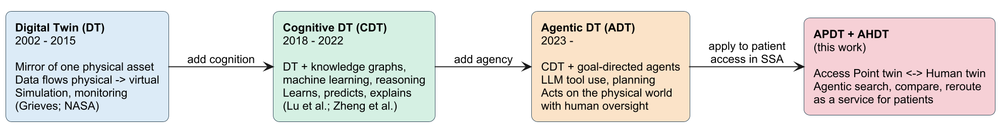{width=100%}

## Research gap

Health digital twin research is dominated by physiological patient twins in high-resource settings (Björnsson et al., 2020; Corral-Acero et al., 2020). Access-to-medicines research in sub-Saharan Africa documents availability, price and travel barriers, but its interventions are rarely real-time or agentic (Cameron et al., 2009; Beyeler, Liu & Sieverding, 2015). Agentic DT research is concentrated in manufacturing (Xia et al., 2023). No prior work, to the author's knowledge, combines (i) a real-time twin of *health access points*, (ii) a bounded, adaptive twin of the *patient as a seeker of care*, and (iii) LLM agents that act across both, delivered as a low-cost service for sub-Saharan cities. This report addresses that gap.

# Analysis and Design of the APDT

The design follows a use-case-driven, object-oriented approach (Jacobson, 1992), expressed in UML (Fowler, 2004). Interactions are modelled as message sequence charts (ITU-T, 2011).

## Functional and non-functional requirements

Requirements were derived from the patient-access problem in Section 2, the AfriSmart architecture and the agentic capabilities in Section 3. Priorities use MoSCoW notation (Must, Should, Could). Non-functional requirements are organised by the quality attributes of ISO/IEC 25010 (ISO/IEC, 2011). The *Status* column records what the current implementation delivers.

Table: Table 4.1 Functional requirements.

| ID | Requirement | Twin | Priority | Status |
|---|---|---|---|---|
| FR1 | Register access points with location, hours and service radius | APDT | Must | Implemented |
| FR2 | Maintain per-product stock and price for each access point | APDT | Must | Implemented |
| FR3 | Compute whether an access point is open now, including overnight hours | APDT | Must | Implemented |
| FR4 | Find access points within a radius that hold a product in sufficient quantity, nearest first | APDT + AHDT | Must | Implemented |
| FR5 | Match products by name, SKU or local alias (e.g. "malaria drug", "Coartem") | APDT | Must | Implemented |
| FR6 | Compare prices and distance and recommend cheapest, nearest and best value | APDT + AHDT | Must | Implemented |
| FR7 | Reroute a request away from a preferred access point that cannot serve it | APDT + AHDT | Must | Implemented |
| FR8 | Reserve stock and place an order atomically, with a tamper-evident hash | Shared | Must | Implemented |
| FR9 | Push stock and order changes to connected clients in real time | APDT | Must | Implemented |
| FR10 | Provide a conversational agent for patients that uses only tool-derived facts | AHDT | Must | Implemented |
| FR11 | Provide a conversational agent for access point operators | APDT | Must | Implemented |
| FR12 | Identify low-stock items with recent demand and a suggested restock quantity | APDT | Should | Implemented |
| FR13 | Require explicit confirmation before orders or stock changes made by an agent | Shared | Must | Implemented (policy in prompts) |
| FR14 | Persist conversations and tool calls, and reuse recent tool results as memory | AHDT | Should | Implemented |
| FR15 | Use the device's location in preference to model-supplied coordinates | AHDT | Must | Implemented |
| FR16 | Embed the consenting patient's AHDT summary in the APDT dashboard | APDT + AHDT | Should | Designed (Section 5.7) |
| FR17 | Prefer access points that are open now when rerouting | APDT | Should | Planned (Section 6) |
| FR18 | Anchor order hashes on a public ledger | Shared | Could | Planned |
| FR19 | Hold clinical context (prescriptions, adherence) in the AHDT using HL7 FHIR | AHDT | Could | Planned |

Table: Table 4.2 Non-functional requirements (quality attributes after ISO/IEC 25010).

| ID | Quality attribute | Requirement | How it is addressed |
|---|---|---|---|
| NFR1 | Performance | Tool calls return in well under one second on commodity hardware | Bounding-box query + in-memory haversine; measured 5–15 ms median (Section 5.8) |
| NFR2 | Low-bandwidth operation | One persistent connection; small JSON frames; works without the AI model | Single WebSocket with request queueing and auto-reconnect; keyword search and orders work without an LLM key |
| NFR3 | Security | Authenticated, role-based access; least privilege for agents | JWT; tools filtered by role; merchant tools check store ownership |
| NFR4 | Privacy and consent | Location used only as supplied by the user's device, per request | Location is request context, never stored on the user; device location overrides model input |
| NFR5 | Safety | No consequential action without human confirmation; no invented facts | Prompt rules; facts only from tools; structured tool errors |
| NFR6 | Auditability | Every order verifiable after the fact | SHA-256 ledger hash over a canonical order record; tool invocations persisted |
| NFR7 | Interoperability | Pluggable LLM providers; standard APIs | OpenAI-compatible engine (OpenAI, Groq, OpenRouter, Ollama); REST with OpenAPI; WebSocket |
| NFR8 | Maintainability | Clear module boundaries that are verified automatically | Spring Modulith modules; architecture test |
| NFR9 | Portability and cost | Runs without external infrastructure for pilots | Embedded H2 database (PostgreSQL mode); file profile; any JDBC URL in production |
| NFR10 | Usability | Patients and operators can complete core tasks without training | Single search box, map, clear stock badges, one-tap ordering; operator tabs for Orders/Inventory/Assistant |

## Use cases and use case narratives

Two actors own the twins: the **patient**, who owns the AHDT, and the **access point operator** (pharmacist or PPMV), who operates the APDT. An external **LLM provider** is a supporting system actor. Figures 4.1 and 4.2 show the use cases.

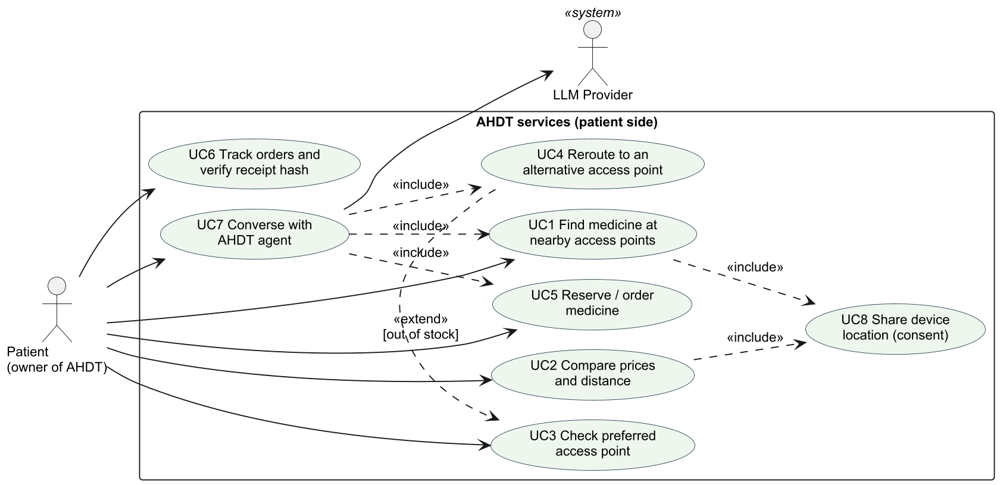{width=100%}

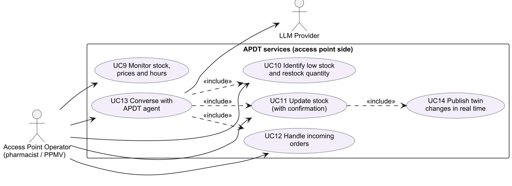{width=100%}

The key use cases are described below.

**UC1 Find medicine at nearby access points**

- *Primary actor:* Patient. *Supporting:* APDT search service.
- *Preconditions:* The patient's device location is known (shared or chosen from a list of places).
- *Main flow:* (1) The patient enters a need in their own words, e.g. "malaria". (2) The system matches the need to products by name, SKU or alias. (3) The system queries APDTs within the selected radius that hold at least the requested quantity. (4) Results are sorted by distance, then price, and shown as a list and on a map, with "Nearest", "Best price" and "Open/Closed now" badges.
- *Alternative flows:* 2a. The query is shorter than two characters: the system asks for more detail. 3a. No access point has stock: the system says so and suggests widening the radius or rerouting (UC4).
- *Postconditions:* The AHDT holds the current need and location for later steps.

**UC3 Check preferred access point** and **UC4 Reroute to an alternative access point**

- *Primary actor:* Patient (directly or through the AHDT agent).
- *Preconditions:* The patient names a usual access point, e.g. "Ojuelegba".
- *Main flow:* (1) The system resolves the name to an access point; several matches trigger a disambiguation question. (2) It returns that APDT's hours, distance and stock for the requested product. (3) If stock is zero, the access point is closed, or quantity is insufficient, UC4 extends the flow. (4) The system excludes the preferred access point, searches twice the normal radius for access points that can supply the full quantity, and returns a recommended alternative with up to five others.
- *Postconditions:* The patient has an actionable alternative with distance and price.

**UC5 Reserve / order medicine**

- *Primary actor:* Patient.
- *Preconditions:* The patient is signed in as a consumer and has chosen an access point and items. When the agent acts, the patient has explicitly confirmed store, items and total in their latest message.
- *Main flow:* (1) The system merges duplicate lines. (2) It locks and decrements each stock line at the access point. (3) It creates the order with status PLACED and computes the SHA-256 ledger hash. (4) After commit, it notifies the patient and operator and broadcasts the stock change.
- *Alternative flows:* 2a. Insufficient stock: the whole order is rejected and nothing is decremented. The agent can then reroute (UC4).
- *Postconditions:* Stock is reserved. The order and its hash are visible to the patient and the operator.

**UC7 Converse with the AHDT agent**

- *Primary actor:* Patient. *Supporting:* LLM provider.
- *Main flow:* (1) The patient writes a message. The client attaches device location and screen context (search, cart, store). (2) The agent builds a prompt from the consumer persona and rules, a session block, recent tool memory, the conversation history and the message. (3) The model requests tools. Each call is executed with the AHDT context and its result returned to the model. Progress is streamed to the client. (4) The loop ends when the model replies without tool calls, or after at most six rounds. (5) The exchange and tool calls are persisted.
- *Alternative flows:* 1a. No LLM key configured: the assistant reports it is offline, and search and ordering still work.

**UC10 Identify low stock and restock quantity**

- *Primary actor:* Access point operator.
- *Main flow:* (1) For each access point the operator owns, the system lists items at or below a threshold (default 10). (2) It totals units sold in the last seven days (excluding cancelled orders). (3) It suggests a restock quantity large enough to cover about two weeks of recent demand (Section 5.2).

**UC11 Update stock (with confirmation)**

- *Primary actor:* Access point operator (directly or via the APDT agent).
- *Main flow:* (1) The operator states the new on-hand quantity (and optionally the price). (2) The agent repeats it back and asks for confirmation. (3) On confirmation, the system checks ownership and updates the twin. (4) It broadcasts `stock.changed` to all connected clients.
- *Alternative flows:* 1a. A new product with no price: the system requires a price.

## Message sequence charts

Figure 4.3 shows the central patient journey. The patient's usual PPMV is out of antimalarials, the AHDT agent reroutes to an alternative APDT, and, after confirmation, places a hash-sealed order whose effects are pushed to all clients. Figure 4.4 shows the operator's restock loop. Figure 4.5 shows how the twins stay synchronised over the WebSocket gateway.

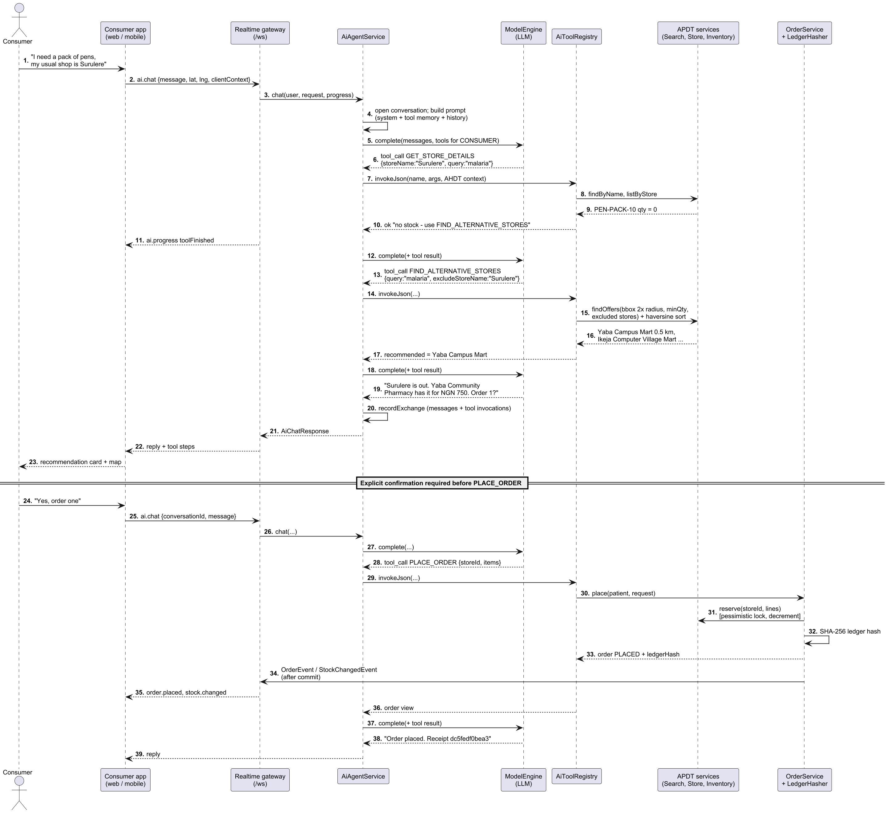{width=100%}

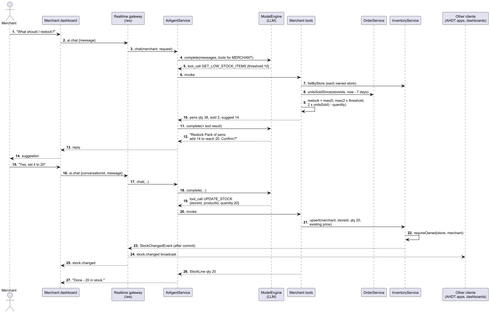{width=100%}

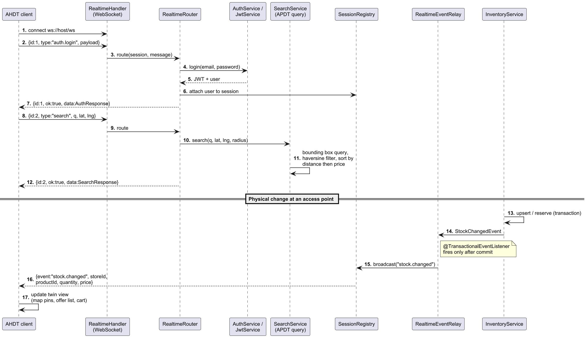{width=100%}

## Complete software framework for the APDT and AHDT

Figure 4.6 shows the complete software framework. It refines the AfriSmart architecture into implementable layers, and Table 4.3 maps the two.

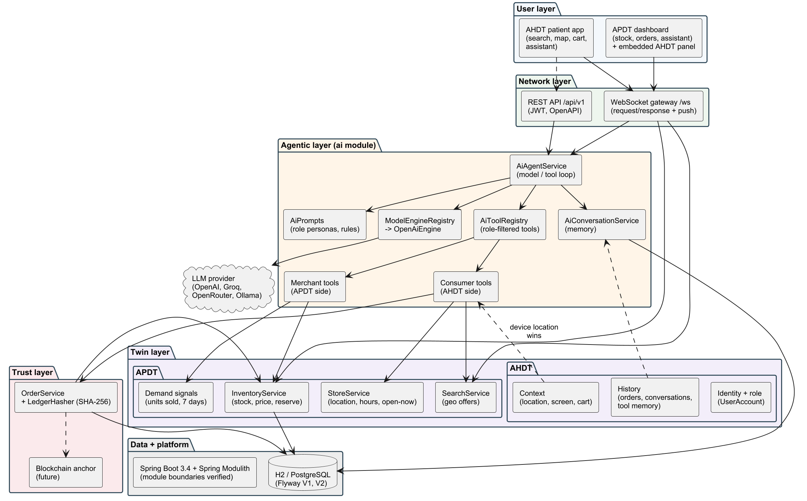{width=100%}

- **User layer.** The patient app (search, map, cart, orders, assistant) is the patient-facing view of the AHDT. The APDT dashboard (orders, inventory, assistant) is the operator's view of the APDT and embeds a consented AHDT summary.
- **Network layer.** A single WebSocket gateway (`/ws`) carries request/response messages (e.g. `search`, `orders.place`, `ai.chat`) and server pushes (`stock.changed`, `order.placed`, `ai.progress`). A REST API (`/api/v1`) with OpenAPI documentation serves integrations.
- **Agentic layer.** `AiAgentService` runs the model/tool loop. `AiPrompts` defines role personas and safety rules. `AiToolRegistry` exposes only the tools a role may use. `ModelEngineRegistry` selects a configured model provider, and `AiConversationService` stores memory.
- **Twin layer.** The APDT comprises store identity, location and hours (`StoreService`), stock and price with atomic reservation (`InventoryService`), geospatial offer search (`SearchService`) and demand signals (`unitsSoldSince`). The AHDT comprises identity and role, request context (device location, screen, cart) and history (orders, conversations, tool memory).
- **Trust layer.** `OrderService` seals each order with `LedgerHasher` (SHA-256). Anchoring to a public blockchain is a planned extension.
- **Data and platform.** Spring Boot 3.4 on Java 21, organised as Spring Modulith modules whose boundaries are verified by a test. Flyway migrations run on embedded H2 (PostgreSQL mode) for pilots, or on any JDBC database in production.

Table: Table 4.3 Mapping the AfriSmart architecture layers to the APDT/AHDT framework.

| AfriSmart layer | Role in APDT/AHDT | Implemented by |
|---|---|---|
| User layer | Patient app; APDT dashboard | React web client (`web/`) |
| Perception layer | Device location, stock, price, hours, preferences | Client context; inventory and store services |
| Network layer | Connectivity and APIs | WebSocket gateway; REST API |
| Support layer (Agentic + DT) | Twins and agents | Twin services; `ai` module |
| Blockchain layer | Tamper-evident records | `LedgerHasher` (anchoring planned) |
| Application layer | Recommendations, price ranges, alternatives, ordering | Search, compare, reroute and order tools and screens |
| Smart city service layer | Retailers, logistics, payments | Access point onboarding (logistics and payments planned) |

**Delivery as a service.** An access point joins by registering an operator account and creating its store. Its APDT, agent tools and dashboard are then available at once, with no hardware, local server or integration work. Multi-tenancy is enforced at the service layer: every merchant operation checks that the operator owns the store (`requireOwned`). This makes the marginal cost of onboarding a PPMV close to zero, which matters for the long tail of small access points.

## Class diagrams

Figure 4.7 shows the twin domain model. The APDT is formed by `Store`, `InventoryItem`, `Product` and `ProductAlias`, plus the `StoreHours` rule and the derived `SalesTally` demand signal. The AHDT is formed by `UserAccount` (identity and role), the per-request `AiToolContext` (device location) and the conversational memory (`AiConversation`, `AiMessage`, `AiToolInvocation`). `CustomerOrder` and `OrderLine` are the transactions that couple the two twins, sealed by `LedgerHasher`.

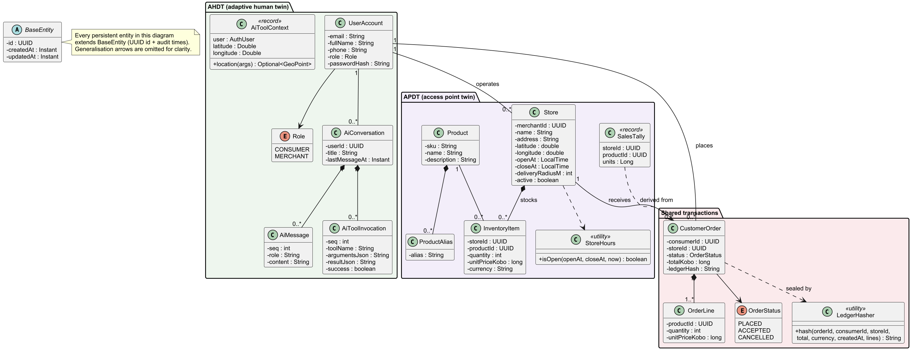{width=100%}

Figure 4.8 shows the agentic layer. Each capability is an `AiTool` with a typed JSON-schema contract and an explicit set of permitted roles. The registry filters tools by role and converts every failure into a structured `ToolResult`. The model engine is behind an interface, so providers can be swapped by configuration.

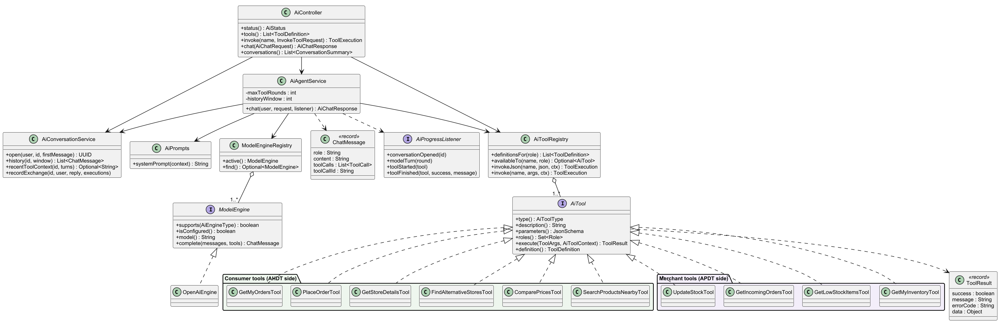{width=100%}

# Implementation

## Technology stack and environment

Table: Table 5.1 Technology stack.

| Concern | Technology |
|---|---|
| Language and runtime | Java 21 |
| Backend framework | Spring Boot 3.4 (Web, Data JPA, Security, Validation, WebSocket, Actuator) |
| Modularity | Spring Modulith (modules: identity, stores, catalog, inventory, marketplace, orders, ai, realtime, shared) |
| Persistence | Hibernate/JPA; Flyway migrations; H2 in PostgreSQL mode (in-memory by default, file profile for persistence) |
| Authentication | JWT (jjwt), BCrypt password hashing; roles CONSUMER and MERCHANT |
| AI | OpenAI-compatible Chat Completions with tool calling; provider, model and base URL set by configuration |
| Real time | Spring WebSocket; transactional event listeners |
| Frontend | React 19, TypeScript, Vite, Tailwind CSS, TanStack Query, Zustand, Leaflet with OpenStreetMap |
| Testing | JUnit 5, Mockito, Spring Boot Test with MockMvc, Spring Modulith architecture verification |

The source is organised so that each twin capability lives in its own module. Module dependencies are checked by an automated architecture test, which prevents, for example, the agent layer from reaching into another module's internals.

## APDT implementation

**State.** Each access point is a `Store` (name, address, latitude, longitude, opening and closing time, delivery radius, active flag) owned by an operator account. Each stocked product is an `InventoryItem` holding quantity and unit price in kobo (integer minor units, avoiding floating-point money errors). `StoreHours.isOpen` computes the open-now state, including overnight hours (e.g. 21:00–02:00) and 24-hour access points (equal open and close times).

**Synchronisation.** Every change to the physical shelf passes through `InventoryService`: operator updates through `upsert`, and patient orders through `reserve`, which takes a pessimistic row lock, checks quantity and decrements atomically. Each change publishes a `StockChangedEvent`. A `@TransactionalEventListener` relays it to all connected clients as `stock.changed` *only after the transaction commits*, so clients never see a state that was rolled back. This makes the APDT a true twin in Kritzinger et al.'s (2018) sense. Data flows automatically from the physical access point to the virtual one, and actions taken through the virtual one (orders, agent stock updates) flow back to change what is reserved on the physical shelf.

**Geospatial search.** Offers are found in two stages so that the system needs no spatial database extension:

1. A bounding box around the patient's position $(\varphi, \lambda)$ for radius $r$ is computed with $\Delta\varphi = r/R$ and $\Delta\lambda = r/(R\cos\varphi)$, where $R = 6\,371\,008.8$ m. A single indexed JPQL query selects stores, products and stock inside the box, filtered by minimum quantity, product match (name, SKU or alias) and excluded stores.
2. Each candidate's exact great-circle distance is computed with the haversine formula (Sinnott, 1984),

$$ d = 2R \arcsin\sqrt{\sin^2\frac{\Delta\varphi}{2} + \cos\varphi_1\cos\varphi_2\sin^2\frac{\Delta\lambda}{2}} $$

Candidates beyond $r$ are discarded, and the rest are sorted by distance and then price. The default radius is 15 km, clamped to between 100 m and 50 km.

**Comparison.** For each product, `COMPARE_PRICES` reports the price range and three picks: the cheapest, the nearest, and the *best value*, which minimises

$$ s = 0.6\,\hat{p} + 0.4\,\hat{d} $$

where $\hat{p}$ and $\hat{d}$ are the offer's min–max normalised price and distance among the candidates.

**Cognition: demand and restock.** `GET_LOW_STOCK_ITEMS` combines the twin's current quantity $q$ with units sold in the last seven days $U_7$, aggregated in the database from non-cancelled orders. For threshold $T$, it suggests

$$ q^{*} = \max\big(0,\ \max(2T,\ 2U_7) - q\big) $$

This is enough to restore a safety buffer of twice the threshold, or roughly two weeks of recent demand, whichever is larger. The rule is deliberately simple and explainable, so an operator can see why a number was suggested.

## AHDT implementation

The AHDT is assembled from four sources:

1. **Identity and role** (`UserAccount`, JWT). The role determines which tools and which persona the agent receives.
2. **Request context** (`AiToolContext`, `AiClientContext`). This is the device location plus what the client is showing: the screen, current search, location label, radius, store and cart. It lets the agent resolve "this", "here" or "my cart" without extra questions. Context is supplied by the user's own device and treated as *context, never authority*. In particular, when the device supplies a location, tools use it in preference to any coordinates the model proposes, so a manipulated prompt cannot make the agent search somewhere else.
3. **History.** This covers orders, and conversations persisted as ordered messages. The last twelve user and assistant turns are replayed to the model.
4. **Adaptive tool memory.** Successful tool calls from the last three turns are summarised (results truncated to about 1,500 characters) and injected as a system message. The agent can then reuse store and product identifiers from earlier steps, so that "yes, order one" refers to the access point it just recommended rather than being guessed.

The AHDT is therefore *adaptive* in three concrete ways. Its context changes with every interaction (location, need, cart). Its stated preferences change the search space: a named usual store is checked first and excluded when rerouting. Its memory accumulates what has already been established. It is deliberately *bounded*. It holds no clinical data in this iteration, consistent with the purpose-limited view of human twins discussed in Section 3.2.

## Agentic layer

**Agent loop.** `AiAgentService.chat` resolves the active model engine, opens or resumes the conversation, and assembles the messages: system prompt, tool memory, history, then the user's message. It then loops for up to six rounds. Each round sends the messages and the role's tool definitions to the model. If the model returns tool calls, each is executed through the registry and its JSON result appended as a `tool` message. Otherwise the model's text is the reply. The service is deliberately not one database transaction. Model calls can take seconds, and each tool commits its own work, so a later model failure does not roll back an order the patient already confirmed. Progress (conversation opened, model turn, tool started or finished) is streamed to the client as `ai.progress` events so the patient sees the agent working.

**Tools.** Table 5.2 lists the ten tools. Each declares a JSON schema for its arguments and the roles allowed to use it. The registry validates and parses arguments, enforces role availability, and converts any exception into a structured error (e.g. `LOCATION_REQUIRED`, `INVALID_TOOL_ARGUMENTS`, `TOOL_NOT_AVAILABLE`), so the model always receives something it can explain to the user.

Table: Table 5.2 Agent tools over the two twins.

| Tool | Role | Twin(s) | Purpose |
|---|---|---|---|
| SEARCH_PRODUCTS_NEARBY | Patient | APDT, AHDT | Access points near the patient with stock, nearest first |
| COMPARE_PRICES | Patient | APDT, AHDT | Price range plus cheapest, nearest and best-value picks |
| FIND_ALTERNATIVE_STORES | Patient | APDT, AHDT | Reroute away from a preferred access point (2× radius, full quantity) |
| GET_STORE_DETAILS | Both | APDT | One access point's hours, open-now, distance and stock |
| PLACE_ORDER | Patient | Shared | Reserve stock and place a hash-sealed order (after confirmation) |
| GET_MY_ORDERS | Patient | AHDT | Recent orders with store, status, items and totals |
| GET_MY_INVENTORY | Operator | APDT | Stock and prices across the operator's access points |
| GET_LOW_STOCK_ITEMS | Operator | APDT | Low stock with 7-day demand and suggested restock |
| GET_INCOMING_ORDERS | Operator | APDT | Orders by status (PLACED, ACCEPTED, CANCELLED, ALL) |
| UPDATE_STOCK | Operator | APDT | Set on-hand quantity (and optionally price) after confirmation |

**Prompts and guardrails.** The patient persona instructs the agent to call `SEARCH_PRODUCTS_NEARBY` or `COMPARE_PRICES` for discovery, and to check a named usual store with `GET_STORE_DETAILS`. If that store is out of stock, closed, or cannot cover the quantity, the agent must not stop: it calls `FIND_ALTERNATIVE_STORES` and recommends the best alternative with distance and price. Before `PLACE_ORDER` it must summarise store, items, quantities and total and ask for confirmation, and after ordering it must give the first twelve characters of the ledger hash as a receipt. The operator persona applies the same confirmation rule to `UPDATE_STOCK` and clarifies that quantity is the new total on the shelf. Common rules require every fact to come from a tool call, keep identifiers out of the conversation, and keep replies short. A session block gives the user's role, local Lagos time and whether the device location is known.

**Pluggable models.** `ModelEngine` is an interface, and `OpenAiEngine` talks to any OpenAI-compatible endpoint. The deployment can therefore use a hosted model or a locally run open model (e.g. via Ollama) where data residency or cost requires it, purely by configuration. Without a key, the chat endpoint returns `503 AI_NOT_CONFIGURED` and the rest of the system keeps working. This graceful degradation is important under unreliable connectivity.

## Real-time twin synchronisation

The web client keeps one WebSocket open for the whole session. Requests carry an identifier and a type, and responses echo the identifier. Requests made while disconnected wait in a queue. On every reconnect the client re-presents its token first, so queued requests run as the signed-in user, and reconnection uses exponential back-off capped at ten seconds. The server pushes three kinds of events: `stock.changed` to everyone (the APDT changed), `order.placed`/`order.updated` to the patient and the owning operator, and `ai.progress` to the requester. Figure 4.5 shows the protocol, and the user interface makes the connection state visible with a "Live" badge.

## Trust: tamper-evident orders

When an order is placed, `LedgerHasher` builds a canonical string from the order identifier, patient, access point, total, currency, creation time, and the order lines sorted by product (product, quantity, unit price). It stores the hex SHA-256 digest with the order. Any later change to any of these fields produces a different hash, so the patient's receipt can be re-verified by recomputation. The canonical form is stable and independent of the database, so the same hash can later be written to a public blockchain or a timestamping service without changing the order model (Section 6.2).

## UI/UX of the APDT dashboard with embedded AHDT dashboard

**Design principles.** The interface follows established usability heuristics (Nielsen, 1993), adapted to low-resource, mobile-first use:

- *Visibility of system status:* "Live" connection badge, stock badges, open/closed state, and agent progress steps.
- *Match with the real world:* local place names, naira prices, and local product names via aliases.
- *Error prevention:* explicit confirmation before orders and stock changes.
- *Recognition rather than recall:* suggested searches and one-tap "Add" and "Place order".
- *Graceful degradation:* every core task works without the AI model.

**Patient-facing AHDT views.** Figure 5.1 shows the patient's search for "malaria" near Yaba. The AHDT's location and need drive the query. Results show only access points that actually hold the medicine, with "Nearest", "Best price" and "Closed now" badges, the price range, distance, stock count and a live map. The patient's usual PPMV does not appear because its twin reports zero stock. Figure 5.2 shows the order confirmation after one tap: stock is reserved at Yaba Community Pharmacy and the ledger hash is displayed with an explanation of what it proves.

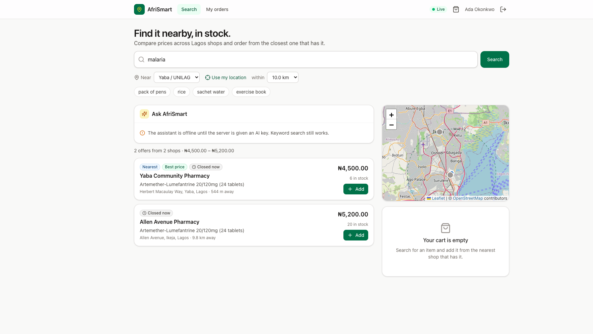{width=100%}

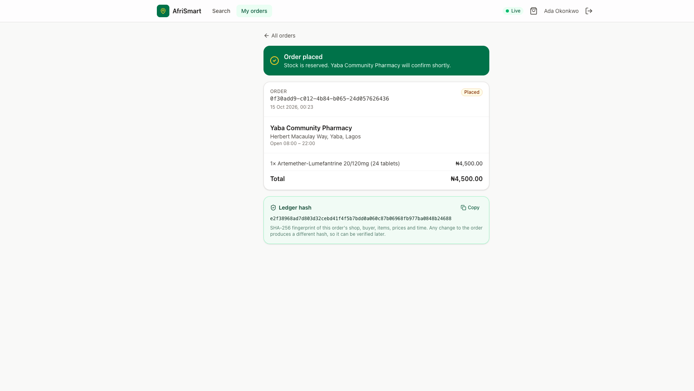{width=100%}

**APDT dashboard.** Figures 5.3 and 5.4 show the operator's dashboard for Yaba Community Pharmacy. The *Orders* tab lists orders needing attention, with the hash prefix and an *Accept* action; the patient's order appeared there in real time. The *Inventory* tab is the editable face of the APDT. Each product shows its current state ("120 in stock", or "Low · 5" for the antimalarial after the patient's order took it from 6 to 5), with inline quantity and price editing. The *Assistant* tab hosts the APDT agent; in the captured run, no model key was configured, so it showed its offline message while orders and inventory continued to work.

{width=100%}

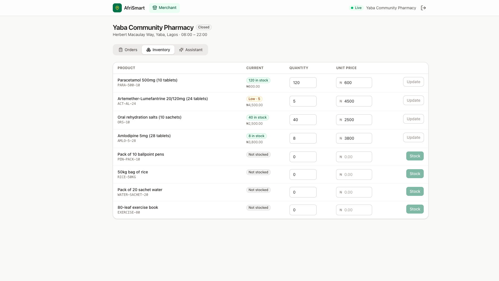{width=100%}

**Embedded AHDT panel (design).** Figure 5.5 presents the design of the integrated dashboard, with the embedded AHDT panel shown beside the APDT. When a patient consents, the operator sees a bounded summary of that patient's twin: approximate distance, current need, the usual access point and why they were rerouted, order count, any predicted refill, and the scope of consent. A journey timeline shows search, stockout, reroute, order and pick-up. The panel turns the operator's view from "an order arrived" into "a patient who could not be served elsewhere is on their way", which supports prioritisation, counselling and follow-up. The data shown is limited to what the AHDT already holds and what the patient consents to share. Section 5.10 records that this embedded panel is designed but not yet built into the web client.

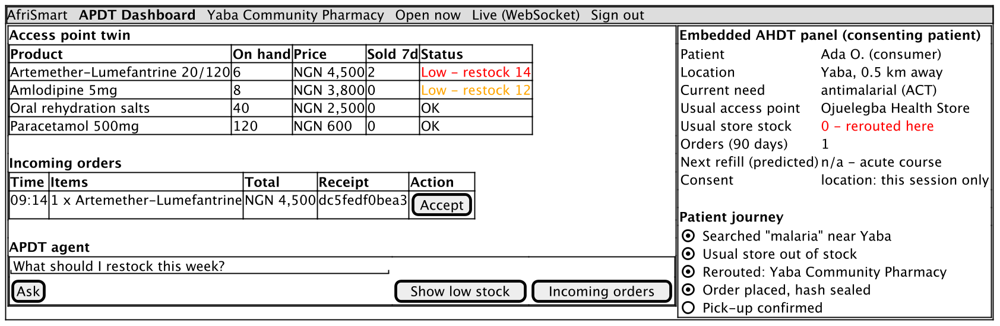{width=100%}

## Testing and evaluation

**Automated tests.** The build runs 29 automated tests, all passing. They are summarised in Table 5.3. The integration tests boot the complete application on H2, with demonstration data, and drive it through HTTP and WebSocket. The agent loop is tested with a *scripted model engine*, a test double that replays predetermined tool calls and replies. This verifies the loop, the tool execution, the message protocol (`tool` messages with the right call identifiers), tool filtering by role, persistence and memory, without depending on a commercial model.

Table: Table 5.3 Automated test suite (all passing).

| Test class | Tests | What it verifies |
|---|---|---|
| AfriSmartIntegrationTest | 9 | Search ranking; preferred-store stockout; reroute; price comparison; role filtering (operator cannot place orders); location required; scripted agent loop with persistence, memory and conversation isolation; order then operator sees incoming order and 7-day sales; public AI status and validation |
| RealtimeIntegrationTest | 4 | WebSocket authentication, request/response routing and server pushes |
| ModulithArchitectureTest | 1 | Module boundaries respected across the codebase |
| OrderServiceTest | 3 | Order placement rules (consumer only, line merging, stock reservation) |
| LedgerHasherTest | 2 | Hash determinism and sensitivity to changes |
| GeoUtilsTest | 4 | Haversine distance (Yaba–Ikeja ≈ 10.5 km), bounding-box correctness, rounding |
| StoreHoursTest | 3 | Daytime, overnight and 24-hour opening rules |
| JwtServiceTest, MoneyTest | 3 | Token issue/validation; naira formatting |

**Scenario evaluation.** A reproducible script (`docs/apdt-report/scripts/scenario.sh`) replays the patient-access scenario against the running system and records every tool output. The patient (Ada, near Yaba at 6.5158° N, 3.3791° E) needs an antimalarial, and her usual access point is the Ojuelegba Health Store, a PPMV. Table 5.4 reports the actual outputs.

Table: Table 5.4 Patient-access scenario: actual system outputs.

| Step | Tool | Actual result |
|---|---|---|
| 1. Search "malaria" | SEARCH_PRODUCTS_NEARBY | 2 offers: Yaba Community Pharmacy, 544 m, ₦4,500, 6 in stock; Allen Avenue Pharmacy, 9.8 km, ₦5,200, 20 in stock. Ojuelegba is excluded because it has zero stock |
| 2. Check usual PPMV | GET_STORE_DETAILS | Ojuelegba Health Store, 1.7 km: artemether-lumefantrine quantity 0. Message: "has no stock … Use FIND_ALTERNATIVE_STORES to reroute" |
| 3. Reroute | FIND_ALTERNATIVE_STORES | Excluded: Ojuelegba Health Store. Search radius 30 km. Recommended: Yaba Community Pharmacy (544 m, ₦4,500) |
| 4. Compare | COMPARE_PRICES | Range ₦4,500–₦5,200 across 2 access points; cheapest = nearest = best value = Yaba Community Pharmacy |
| 5. Order 2 packs | PLACE_ORDER | PLACED, total ₦9,000, ledger hash `32dbc31ef68c…af1ede2` |
| 6. Operator: incoming | GET_INCOMING_ORDERS | 1 PLACED order with the same hash |
| 7. Operator: low stock | GET_LOW_STOCK_ITEMS (T = 10) | Artemether-lumefantrine: 4 on hand, 2 sold in 7 days, suggested restock 16; amlodipine: 8 on hand, suggested restock 12 |
| 8. Role check | PLACE_ORDER as operator | HTTP 403 TOOL_NOT_AVAILABLE |

The restock suggestion in step 7 follows the formula exactly: $\max(0, \max(20, 4) - 4) = 16$. The same journey was then repeated through the web interface (Figures 5.1–5.4). Placing one pack moved the pharmacy's twin from 6 to 5 units, which the operator's inventory displayed as "Low · 5" without a page refresh.

**Performance.** Table 5.5 reports warm-path latency for the read-only tools: 30 timed calls after five warm-up calls, over HTTP on the same machine (Intel Core i7-1068NG7, 16 GB RAM, in-memory H2). The first call after start-up took about 1.5 s because of JVM warm-up. These figures exclude LLM inference time, which in a conversational turn dominates and depends on the provider.

Table: Table 5.5 Warm-path tool latency (n = 30 per tool).

| Tool | Median (ms) | 95th percentile (ms) | Mean (ms) |
|---|---|---|---|
| SEARCH_PRODUCTS_NEARBY | 7.6 | 10.3 | 8.2 |
| GET_STORE_DETAILS | 14.8 | 22.1 | 16.6 |
| FIND_ALTERNATIVE_STORES | 9.2 | 12.6 | 9.6 |
| COMPARE_PRICES | 5.1 | 11.2 | 6.1 |

## Answers to the research questions

**RQ1: How can an APDT represent and synchronise the real-time state of health access points?** It does so by modelling each access point as a small, explicit twin and routing every physical change through it. The twin covers location, hours and open-now state, per-product stock and price, and a demand signal. Every reservation and stock update is a transaction on the twin, and a post-commit event pushes the new state to every connected client over one WebSocket. In the evaluation, a patient's order changed the pharmacy's twin from 6 to 5 units, and the operator's dashboard reflected it immediately (Figure 5.4). The design suits low-resource conditions. It needs no IoT hardware, since the operator's phone or the order flow itself is the sensor. It runs on an embedded database with millisecond-level queries (Table 5.5), and it uses a single, resumable connection. The limitation is that a twin is only as accurate as its updates: sales that bypass the platform must still be recorded by the operator (Section 6.1).

**RQ2: How can an AHDT adapt to a patient's context so they reach an access point that can serve them?** It does so by bounding the patient twin to the decision at hand and letting it change with each interaction. The AHDT combines device location (which takes precedence over model-supplied coordinates), current need and screen context, stated preferences (the usual store), history and tool memory. In the scenario, the patient's usual PPMV was checked first, found to have zero stock and excluded. Searches with her location returned only access points that could actually supply her (Table 5.4, steps 1–3). Tool memory let a follow-up such as "yes, order one" act on the recommended pharmacy without re-searching, and the scripted-agent integration test verifies that earlier tool results are fed back on later turns. The benefit to the patient is the avoided wasted journey: in the scenario, a 1.7 km trip to a shop with no stock is replaced by a 0.5 km trip to a shop that has it, at the lowest available price.

**RQ3: How can agentic AI over the twins act autonomously while keeping humans in control?** It does so by exposing the twins to the agent only through typed, role-filtered tools and by separating *informational* autonomy from *consequential* actions. The agent may search, check, compare and reroute without asking, so a stockout never ends the patient's journey: the prompt requires `FIND_ALTERNATIVE_STORES` whenever the preferred access point cannot serve. Orders and stock changes, however, require an explicit confirmation in the user's latest message, and tool permissions are enforced in code. An operator cannot place orders (HTTP 403 in step 8), and merchant tools check store ownership. Hallucination risk is reduced by requiring every fact to come from a tool call and by returning structured errors the model can explain. One limitation remains. The confirmation rule is enforced by the prompt rather than by code, and the agent loop has been verified with a scripted model rather than evaluated with real users and real models (Section 5.10).

**RQ4: How can transactions be made tamper-evident and the capability delivered as a service?** Every order is sealed with a SHA-256 hash over a canonical record of the patient, access point, items, prices and time. The patient sees it as a receipt (Figure 5.2) and the operator sees the same hash on the order (Figure 5.3), so either party can detect a later change by recomputation. This is the property a blockchain provides, and it is ready to be anchored on one. The capability is delivered as a multi-tenant service: an access point registers, creates its store and immediately gains a twin, a dashboard, agent tools and discoverability, with ownership enforced on every operation. Pluggable model providers and an embedded database keep the cost of operating the service low, which is a precondition for adoption by small PPMVs.

**Overall.** Taken together, the answers show how APDT-as-a-Service benefits patients in sub-Saharan Africa. It makes the invisible state of access points visible. It turns a stockout from a dead end into an automatic reroute, shortens and de-risks the journey to treatment, makes prices comparable, and gives patients and operators a shared, verifiable record of each transaction.

## Limitations and threats to validity

- **Embedded AHDT panel not yet built.** The APDT dashboard and patient AHDT views are implemented and shown from the live system. The embedded AHDT panel inside the APDT dashboard (Figure 5.5) is a design that has not yet been implemented in the web client.
- **No live-model or user evaluation.** The agent loop was verified with a scripted model engine. Answer quality with commercial or open LLMs, and usability with real patients and operators, have not yet been measured.
- **Availability is shown but not used for ranking.** The scenario ran near midnight Lagos time, and every access point correctly reported "Closed now", yet search and reroute still ranked them by distance and price alone. The patient prompt tells the agent to treat a closed store as unable to serve, but the tools do not yet filter or down-rank closed access points (FR17).
- **Synthetic data.** Access points, prices and stock are seeded demonstration data for Lagos. Distances are straight-line, not travel time.
- **Twin fidelity depends on updates.** Sales made outside the platform must be recorded by the operator, or the twin drifts from the shelf.
- **Confirmation enforced by prompt.** Explicit confirmation before orders and stock updates is a prompt rule, so a sufficiently adversarial prompt could still bypass it.
- **Ledger not yet anchored.** Hashes are tamper-evident within the platform but are not yet anchored externally.
- **Performance figures are local.** Latency was measured on one laptop with an in-memory database and excludes model inference and network latency.

# Conclusion

This report set out to show how an Access Point Digital Twin, co-developed with an Adaptive Human Digital Twin and delivered as a service, can benefit patients in sub-Saharan Africa. Grounded in the evolution from digital twins to cognitive and agentic twins, it specified requirements, use cases, message sequence charts, a complete software framework and class diagrams. It then implemented the design on the AfriSmart platform. The APDT keeps a real-time, synchronised model of each access point's location, hours, stock, prices and demand. The AHDT models the patient as a seeker of care: location, need, preferences, history and memory. Tool-using LLM agents act across both twins to search, compare and reroute autonomously, but take consequential actions only with confirmation. Every order is sealed with a verifiable hash.

The evaluation demonstrated the core benefit concretely. When a patient's usual medicine vendor had no antimalarials, the system rerouted her to a nearby pharmacy with stock at the lowest price, and reserved and sealed the order. The pharmacy's twin and dashboard updated in real time, and its restock recommendation followed from the new demand. All 29 automated tests passed, and twin queries completed in milliseconds on commodity hardware.

## Recommendations

1. **Make availability part of routing.** Filter or down-rank access points that are closed, or will close before the patient can arrive, and say so in the recommendation (FR17). This is the most direct improvement suggested by the evaluation.
2. **Enforce consequential-action confirmation in code.** Require a confirmation token, issued when the agent presents a summary and checked by `PLACE_ORDER` and `UPDATE_STOCK`, so the guardrail does not depend on the model following its prompt.
3. **Build the embedded AHDT panel with explicit, revocable consent.** Implement the designed panel (Figure 5.5) and record consent scope and duration in the AHDT, in line with the Nigeria Data Protection Act 2023 (Federal Republic of Nigeria, 2023).
4. **Keep twins accurate with low-friction updates.** Offer operators quick stock updates by voice, USSD or WhatsApp message through the APDT agent, and reconcile periodically, so that sales outside the platform do not cause drift.
5. **Evaluate with real users and models.** Pilot with a small number of pharmacies and PPMVs and their patients, and measure task success, journeys avoided, time to treatment and agent answer accuracy across model providers, including locally hosted open models.
6. **Partner with regulators.** Integrate verification of access point licences (e.g. pharmacy and PPMV registers) so the APDT signals legitimacy, which addresses the falsified-medicine risk at the access point level.

## Future directions

- **Clinical-grade AHDT.** Extend the AHDT with prescriptions, chronic-medicine refill cycles and adherence, using HL7 FHIR resources (HL7 International, 2019), so it can anticipate a refill and pre-reserve stock at an open access point on the patient's route.
- **Predictive APDT cognition.** Replace the seven-day heuristic with demand forecasting that accounts for seasonality (e.g. malaria seasons) and with stock-out prediction across neighbouring access points, which moves the APDT towards a full cognitive twin.
- **Public ledger anchoring and provenance.** Anchor order hashes on a public blockchain or timestamping service and link them to product batch identifiers, enabling end-to-end provenance checks against falsified medicines.
- **Travel-time and multi-modal routing.** Replace straight-line distance with travel time over road and transit networks, using approaches from global travel-time mapping (Weiss et al., 2020).
- **Inter-twin negotiation.** Let APDT agents of neighbouring access points share and transfer stock to meet unmet demand, a step towards a city-scale twin of medicine availability for public-health planning (Kamel Boulos & Zhang, 2021).
- **Offline-first and low-end devices.** Provide SMS/USSD and offline-capable clients so that patients without data plans can still query the twins.

# References {-}

Abburu, S., Berre, A.J., Jacoby, M., Roman, D., Stojanovic, L. and Stojanovic, N. (2020) 'COGNITWIN – Hybrid and cognitive digital twins for the process industry', *2020 IEEE International Conference on Engineering, Technology and Innovation (ICE/ITMC)*, pp. 1–8.

Anthropic (2024) *Introducing the Model Context Protocol*. Available at: https://www.anthropic.com/news/model-context-protocol.

Aranda-Jan, C.B., Mohutsiwa-Dibe, N. and Loukanova, S. (2014) 'Systematic review on what works, what does not work and why of implementation of mobile health (mHealth) projects in Africa', *BMC Public Health*, 14, 188.

Batty, M. (2018) 'Digital twins', *Environment and Planning B: Urban Analytics and City Science*, 45(5), pp. 817–820.

Beyeler, N., Liu, J. and Sieverding, M. (2015) 'A systematic review of the role of proprietary and patent medicine vendors in healthcare provision in Nigeria', *PLoS ONE*, 10(1), e0117165.

Björnsson, B., Borrebaeck, C., Elander, N., Gasslander, T., Gawel, D.R., Gustafsson, M. et al. (2020) 'Digital twins to personalize medicine', *Genome Medicine*, 12, 4.

Boschert, S. and Rosen, R. (2016) 'Digital twin – the simulation aspect', in Hehenberger, P. and Bradley, D. (eds) *Mechatronic Futures*. Cham: Springer, pp. 59–74.

Bruynseels, K., Santoni de Sio, F. and van den Hoven, J. (2018) 'Digital twins in health care: ethical implications of an emerging engineering paradigm', *Frontiers in Genetics*, 9, 31.

Cameron, A., Ewen, M., Ross-Degnan, D., Ball, D. and Laing, R. (2009) 'Medicine prices, availability, and affordability in 36 developing and middle-income countries: a secondary analysis', *The Lancet*, 373(9659), pp. 240–249.

Corral-Acero, J., Margara, F., Marciniak, M., Rodero, C., Loncaric, F., Feng, Y. et al. (2020) 'The "Digital Twin" to enable the vision of precision cardiology', *European Heart Journal*, 41(48), pp. 4556–4564.

Federal Republic of Nigeria (2023) *Nigeria Data Protection Act, 2023*. Abuja: Federal Government of Nigeria.

Fowler, M. (2004) *UML Distilled: A Brief Guide to the Standard Object Modeling Language*. 3rd edn. Boston: Addison-Wesley.

Fuller, A., Fan, Z., Day, C. and Barlow, C. (2020) 'Digital twin: enabling technologies, challenges and open research', *IEEE Access*, 8, pp. 108952–108971.

Glaessgen, E. and Stargel, D. (2012) 'The digital twin paradigm for future NASA and U.S. Air Force vehicles', *53rd AIAA/ASME/ASCE/AHS/ASC Structures, Structural Dynamics and Materials Conference*, Honolulu, AIAA 2012-1818.

Grieves, M. (2014) *Digital Twin: Manufacturing Excellence through Virtual Factory Replication*. White paper. Florida Institute of Technology.

Grieves, M. and Vickers, J. (2017) 'Digital twin: mitigating unpredictable, undesirable emergent behavior in complex systems', in Kahlen, F.-J., Flumerfelt, S. and Alves, A. (eds) *Transdisciplinary Perspectives on Complex Systems*. Cham: Springer, pp. 85–113.

GSMA (2023) *The Mobile Economy Sub-Saharan Africa 2023*. London: GSMA Intelligence.

HL7 International (2019) *FHIR Release 4 (R4)*. Available at: https://hl7.org/fhir/R4/.

ISO (2021) *ISO 23247-1:2021 Automation systems and integration — Digital twin framework for manufacturing — Part 1: Overview and general principles*. Geneva: International Organization for Standardization.

ISO/IEC (2011) *ISO/IEC 25010:2011 Systems and software engineering — Systems and software Quality Requirements and Evaluation (SQuaRE) — System and software quality models*. Geneva: ISO.

ITU-T (2011) *Recommendation Z.120: Message Sequence Chart (MSC)*. Geneva: International Telecommunication Union.

Jacobson, I. (1992) *Object-Oriented Software Engineering: A Use Case Driven Approach*. Wokingham: Addison-Wesley.

Ji, Z., Lee, N., Frieske, R., Yu, T., Su, D., Xu, Y. et al. (2023) 'Survey of hallucination in natural language generation', *ACM Computing Surveys*, 55(12), pp. 1–38.

Jones, D., Snider, C., Nassehi, A., Yon, J. and Hicks, B. (2020) 'Characterising the digital twin: a systematic literature review', *CIRP Journal of Manufacturing Science and Technology*, 29, pp. 36–52.

Kamel Boulos, M.N. and Zhang, P. (2021) 'Digital twins: from personalised medicine to precision public health', *Journal of Personalized Medicine*, 11(8), 745.

Kritzinger, W., Karner, M., Traar, G., Henjes, J. and Sihn, W. (2018) 'Digital twin in manufacturing: a categorical literature review and classification', *IFAC-PapersOnLine*, 51(11), pp. 1016–1022.

Lee, E.A. (2008) 'Cyber physical systems: design challenges', *11th IEEE International Symposium on Object and Component-Oriented Real-Time Distributed Computing (ISORC)*, pp. 363–369.

Lu, J., Zheng, X., Gharaei, A., Kalaitzakis, K. and Kiritsis, D. (2020) 'Cognitive twins for supporting decision-makings of Internet of Things systems', in Wang, L., Majstorovic, V., Mourtzis, D., Carpanzano, E., Moroni, G. and Galantucci, L. (eds) *Proceedings of 5th International Conference on the Industry 4.0 Model for Advanced Manufacturing*. Cham: Springer, pp. 105–115.

Mell, P. and Grance, T. (2011) *The NIST Definition of Cloud Computing*. NIST Special Publication 800-145. Gaithersburg: National Institute of Standards and Technology.

Mettler, M. (2016) 'Blockchain technology in healthcare: the revolution starts here', *2016 IEEE 18th International Conference on e-Health Networking, Applications and Services (Healthcom)*, pp. 1–3.

Miller, M.E. and Spatz, E. (2022) 'A unified view of a human digital twin', *Human-Intelligent Systems Integration*, 4, pp. 23–33.

Nakamoto, S. (2008) *Bitcoin: A Peer-to-Peer Electronic Cash System*. Available at: https://bitcoin.org/bitcoin.pdf.

Negri, E., Fumagalli, L. and Macchi, M. (2017) 'A review of the roles of digital twin in CPS-based production systems', *Procedia Manufacturing*, 11, pp. 939–948.

Nielsen, J. (1993) *Usability Engineering*. Boston: Academic Press.

OpenAI (2023) *Function calling and other API updates*. Available at: https://openai.com/index/function-calling-and-other-api-updates/.

Ouma, P.O., Maina, J., Thuranira, P.N., Macharia, P.M., Alegana, V.A., English, M., Okiro, E.A. and Snow, R.W. (2018) 'Access to emergency hospital care provided by the public sector in sub-Saharan Africa in 2015: a geocoded inventory and spatial analysis', *The Lancet Global Health*, 6(3), pp. e342–e350.

OWASP (2023) *OWASP Top 10 for Large Language Model Applications*. Available at: https://owasp.org/www-project-top-10-for-large-language-model-applications/.

Park, J.S., O'Brien, J., Cai, C.J., Morris, M.R., Liang, P. and Bernstein, M.S. (2023) 'Generative agents: interactive simulacra of human behavior', *Proceedings of the 36th Annual ACM Symposium on User Interface Software and Technology (UIST '23)*, pp. 1–22.

Rasheed, A., San, O. and Kvamsdal, T. (2020) 'Digital twin: values, challenges and enablers from a modeling perspective', *IEEE Access*, 8, pp. 21980–22012.

Russell, S. and Norvig, P. (2021) *Artificial Intelligence: A Modern Approach*. 4th edn. Hoboken: Pearson.

Schick, T., Dwivedi-Yu, J., Dessì, R., Raileanu, R., Lomeli, M., Zettlemoyer, L., Cancedda, N. and Scialom, T. (2023) 'Toolformer: language models can teach themselves to use tools', *Advances in Neural Information Processing Systems 36 (NeurIPS 2023)*.

Shafto, M., Conroy, M., Doyle, R., Glaessgen, E., Kemp, C., LeMoigne, J. and Wang, L. (2012) *Modeling, Simulation, Information Technology & Processing Roadmap*. Technology Area 11. Washington, DC: NASA.

Sharma, A., Kosasih, E., Zhang, J., Brintrup, A. and Calinescu, A. (2022) 'Digital twins: state of the art theory and practice, challenges, and open research questions', *Journal of Industrial Information Integration*, 30, 100383.

Shengli, W. (2021) 'Is human digital twin possible?', *Computer Methods and Programs in Biomedicine Update*, 1, 100014.

Shneiderman, B. (2020) 'Human-centered artificial intelligence: reliable, safe & trustworthy', *International Journal of Human–Computer Interaction*, 36(6), pp. 495–504.

Sinnott, R.W. (1984) 'Virtues of the haversine', *Sky and Telescope*, 68(2), p. 159.

Tao, F., Zhang, H., Liu, A. and Nee, A.Y.C. (2019) 'Digital twin in industry: state-of-the-art', *IEEE Transactions on Industrial Informatics*, 15(4), pp. 2405–2415.

Wafula, F.N. and Goodman, C.A. (2010) 'Are interventions for improving the quality of services provided by specialized drug shops effective in sub-Saharan Africa? A systematic review of the literature', *International Journal for Quality in Health Care*, 22(4), pp. 316–323.

Wang, L., Ma, C., Feng, X., Zhang, Z., Yang, H., Zhang, J. et al. (2024) 'A survey on large language model based autonomous agents', *Frontiers of Computer Science*, 18(6), 186345.

Weiss, D.J., Nelson, A., Vargas-Ruiz, C.A., Gligorić, K., Bavadekar, S., Gabrilovich, E. et al. (2020) 'Global maps of travel time to healthcare facilities', *Nature Medicine*, 26, pp. 1835–1838.

WHO (2017a) *A Study on the Public Health and Socioeconomic Impact of Substandard and Falsified Medical Products*. Geneva: World Health Organization.

WHO (2017b) *WHO Global Surveillance and Monitoring System for Substandard and Falsified Medical Products*. Geneva: World Health Organization.

WHO (2023a) *WHO Model List of Essential Medicines – 23rd List*. Geneva: World Health Organization.

WHO (2023b) *World Malaria Report 2023*. Geneva: World Health Organization.

WHO and World Bank (2023) *Tracking Universal Health Coverage: 2023 Global Monitoring Report*. Geneva: World Health Organization and International Bank for Reconstruction and Development / The World Bank.

Wooldridge, M. and Jennings, N.R. (1995) 'Intelligent agents: theory and practice', *The Knowledge Engineering Review*, 10(2), pp. 115–152.

Xi, Z., Chen, W., Guo, X., He, W., Ding, Y., Hong, B. et al. (2023) 'The rise and potential of large language model based agents: a survey', *arXiv preprint* arXiv:2309.07864.

Xia, Y., Shenoy, M., Jazdi, N. and Weyrich, M. (2023) 'Towards autonomous system: flexible modular production system enhanced with large language model agents', *2023 IEEE 28th International Conference on Emerging Technologies and Factory Automation (ETFA)*, pp. 1–8.

Yao, S., Zhao, J., Yu, D., Du, N., Shafran, I., Narasimhan, K. and Cao, Y. (2023) 'ReAct: synergizing reasoning and acting in language models', *International Conference on Learning Representations (ICLR 2023)*.

Zheng, X., Lu, J. and Kiritsis, D. (2022) 'The emergence of cognitive digital twin: vision, challenges and opportunities', *International Journal of Production Research*, 60(24), pp. 7610–7632.
