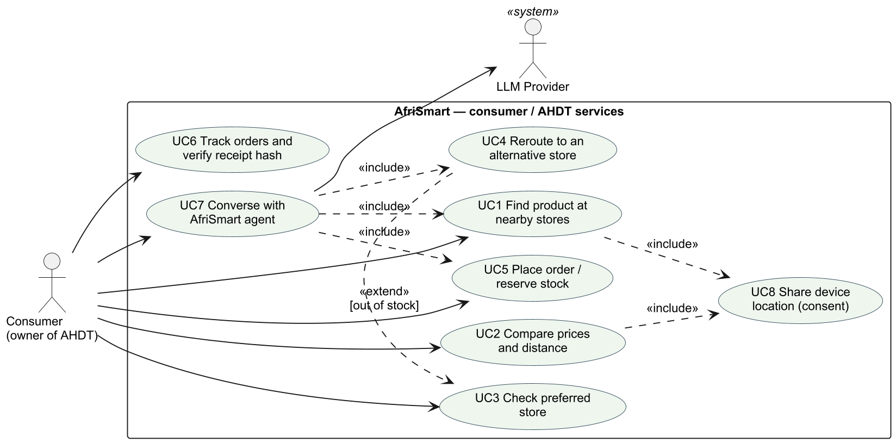
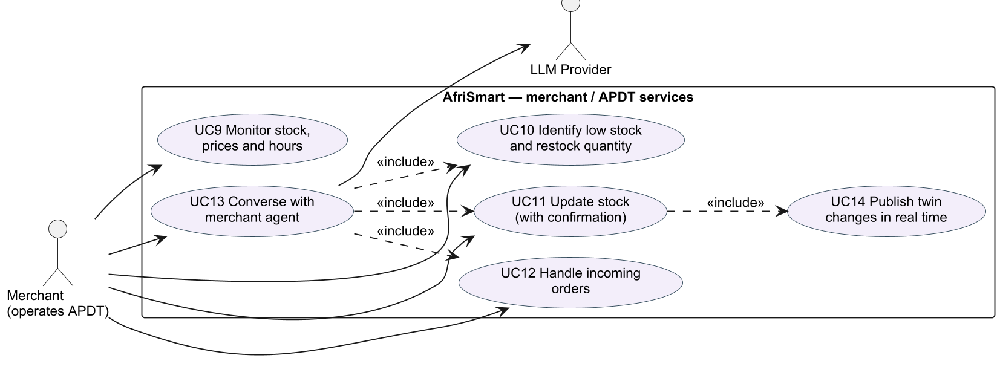
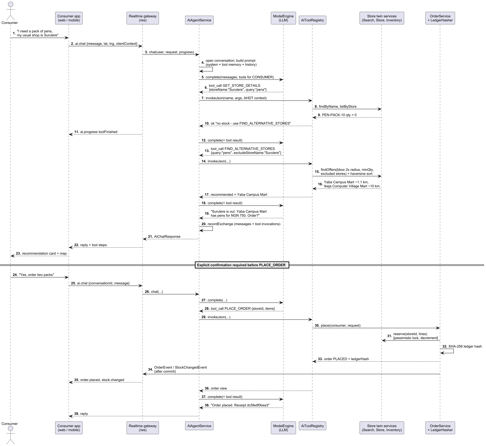
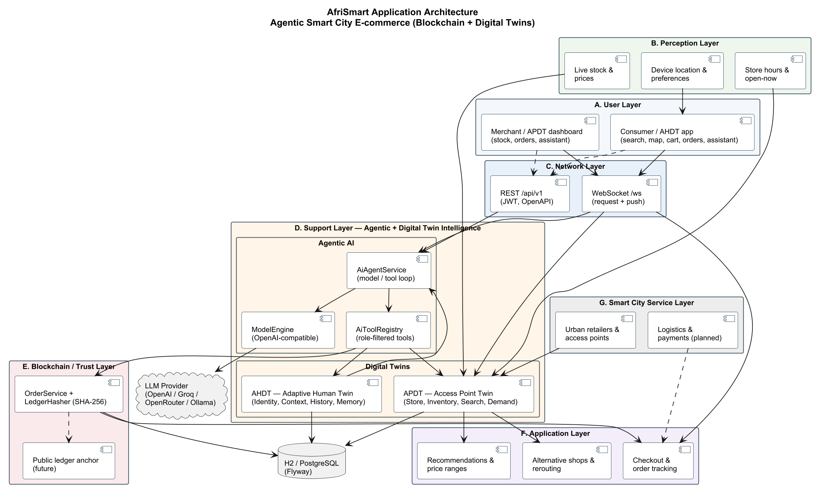

# Abstract

Low-resource African cities face persistent barriers to reliable access to everyday goods. Retail is fragmented across neighbourhood kiosks, markets and small chains; inventory is invisible outside each shop; prices vary without explanation; and a preferred store that is out of stock forces another costly trip. These frictions waste time and transport money, weaken local merchants, and leave urban “smart city” programmes without a working marketplace of last-mile suppliers.

This dissertation motivates, designs and implements **AfriSmart**: an **agentic smart-city e-commerce platform** that combines **digital twins**, **large language model (LLM) agents with tool calling**, and **tamper-evident blockchain-style order hashing**. Each physical store is modelled as an **Access Point Digital Twin (APDT)**—location, hours, live stock and prices, and demand signals. Each shopper is modelled as an **Adaptive Human Digital Twin (AHDT)**—identity, consented device location, current need, preferences, order history and conversation memory. Agentic AI sits between the twins: it searches nearby stocked shops, compares prices, **reroutes** when the preferred shop is empty, and places orders only after explicit confirmation. Every order is sealed with a SHA-256 ledger hash ready for later public-ledger anchoring.

The platform is delivered on a Spring Boot (Java 21) and React stack with a seven-layer **application architecture** (user, perception, network, agentic + digital twin support, blockchain/trust, application, and smart-city service layers). Evaluation on seeded Lagos data (Yaba, Surulere, Ikeja) shows that a consumer searching for a “pack of pens” is not routed to Surulere Stationers (zero stock) but to Yaba Campus Mart (~1.1 km, ₦750), with Ikeja as a farther alternative; role-filtered tools prevent a merchant from placing consumer orders; warm-path tool latency is 5–15 ms (median) on a commodity laptop; and 29 automated tests pass, including a scripted agent loop without a live LLM key.

**Keywords:** smart city, e-commerce, digital twin, cognitive digital twin, agentic AI, blockchain, sub-Saharan Africa, tool calling, geospatial search, Lagos.

\newpage

# Introduction

## Background

Sub-Saharan Africa is urbanising rapidly. Cities such as Lagos concentrate demand for stationery, food staples, household goods and other everyday products, yet the **supply side** remains a dense mosaic of independent shops whose stock and prices are known only inside the shop. Consumers typically rely on a small set of nearby stores. When those stores stock out—or never stocked the item in the first place—the consumer walks further, pays more, or abandons the purchase. Merchants, for their part, lack demand signals beyond what they sell over the counter, so restocking is reactive and wasteful.

These are not only retail problems; they are **smart-city** problems. A smart city is often defined as an urban system that uses information and communication technologies to improve services, efficiency and quality of life (Batty et al., 2012; Chourabi et al., 2012). In African cities, “smart” must mean **inclusive and resource-aware**: solutions that work on mobile networks, do not require every shop to run a data centre, and reduce wasted trips rather than adding another opaque marketplace. Mobile-phone ownership and mobile data coverage have expanded substantially across the region (GSMA, 2023), creating a realistic channel for location-aware commerce if the **information about inventory** can be made trustworthy and actionable.

Two technology trajectories now make that possible. **Digital twins (DTs)** provide continuously synchronised virtual representations of physical assets—here, shops and, at a bounded level, shoppers (Grieves & Vickers, 2017; Kritzinger et al., 2018; Batty, 2018). **Agentic AI**—LLMs that plan and call external tools—can act over those twins: search, compare, decide and request confirmation before irreversible actions (Yao et al., 2023; OpenAI, 2023; Wang et al., 2024). **Blockchain** and related cryptographic hashing supply tamper evidence for orders and a path to multiparty trust without requiring every transaction to settle on a public chain from day one (Nakamoto, 2008; Mettler, 2016).

AfriSmart brings these together as an **agentic smart-city e-commerce platform** for low-resource African environments. The motivating scenario from the architecture design is concrete: a consumer near Yaba / UNILAG needs a **pack of pens**; Surulere Stationers (the preferred shop) has none; the agent finds Yaba Campus Mart in stock at a lower price than Ikeja Computer Village Mart and completes a hash-sealed order after confirmation.

## Research questions

The overarching question is: *how can an agentic smart-city e-commerce platform, powered by digital twins and blockchain, benefit people in sub-Saharan Africa?* It is decomposed as follows:

- **RQ1 (Access and discovery).** How can the platform connect consumers to the nearest shops that actually have a product in stock, under urban geospatial constraints and without specialised spatial databases?
- **RQ2 (Agency and continuity).** How can agentic AI autonomously search, compare prices and **reroute** purchase requests when a preferred store is out of stock, while keeping humans in control of checkout and stock changes?
- **RQ3 (Twin synchronisation).** How can store digital twins (APDTs) and adaptive human twins (AHDTs) stay consistent with physical stock and consumer context in real time on commodity infrastructure?
- **RQ4 (Trust and inclusion).** How can orders be made tamper-evident, and how can the platform be delivered so that small merchants can participate without heavy local IT—thereby supporting inclusive urban digital economies?

## Aim and objectives

**Aim.** To design, architect, implement and evaluate an agentic smart-city e-commerce platform (AfriSmart) that uses digital twins and blockchain-oriented trust mechanisms to improve access to goods for consumers and operational visibility for merchants in sub-Saharan African cities, using Lagos as the case study.

**Objectives.**

1. Review the historical development of digital twins (DTs → cognitive DTs → agentic DTs) and related work on smart cities, e-commerce, agents and blockchain (Section 3).
2. Elicit functional and non-functional requirements for the platform (Section 4.1).
3. Specify use cases and narratives, message sequence charts, the complete software framework, **application architecture**, and class diagrams (Sections 4.2–4.5).
4. Implement the platform (backend, agentic tools, real-time sync, trust hashing, consumer and merchant UI) and evaluate it (Section 5).
5. Answer RQ1–RQ4 from the implementation evidence (Section 5).
6. Provide recommendations and future directions (Section 6).

## Scope and contribution

**In scope:** identity and roles (consumer / merchant); store and inventory twins; geospatial offer search; agentic tools and chat loop; WebSocket and REST APIs; SHA-256 order hashing; consumer search/cart/orders UI; merchant inventory/orders/assistant dashboard; Lagos demonstration data.

**Out of scope (future work):** full public-chain settlement, payments, last-mile logistics, IoT shelf sensors, multi-city deployment studies, and large-scale field trials with real merchants.

**Contributions:** (i) a master-level design linking smart-city e-commerce needs in SSA to agentic DTs; (ii) a seven-layer **application architecture** mapped to a running Spring Modulith system; (iii) a reproducible pack-of-pens / reroute implementation with automated tests and measured tool latency.

## Structure of the report

Section 3 is the literature review. Section 4 presents analysis and design, including application architecture. Section 5 describes implementation, UI/UX and answers the research questions. Section 6 concludes.

\newpage

# Literature Review

## Origins of the digital twin

The idea of pairing a physical object with a virtual counterpart that tracks it through its life is usually traced to Michael Grieves’s work on product lifecycle management: a “mirrored spaces” model with a real space, a virtual space and the linking information flows (Grieves, 2014; Grieves & Vickers, 2017). NASA’s roadmaps popularised the term *digital twin* (Shafto et al., 2012). Glaessgen and Stargel (2012) gave an influential aerospace definition emphasising multiphysics simulation of an as-built vehicle that mirrors its flying twin. In this first generation, the twin’s purpose is to **mirror and simulate**: data flows from the physical asset to the model for monitoring, prediction and what-if analysis (Boschert & Rosen, 2016).

Kritzinger et al. (2018) clarified maturity by data-flow automation. A **digital model** has manual links both ways; a **digital shadow** automates physical→virtual flows; a **digital twin** automates both directions so the virtual object can also change the physical one. Surveys catalogue DT components (physical entity, virtual entity, connection, data, services) and enablers such as IoT, cloud and machine learning (Tao et al., 2019; Jones et al., 2020; Fuller et al., 2020). Urban DTs differ from engineering twins because people and institutions are part of the “physical” system (Batty, 2018)—a point that matters when twinning shops and shoppers rather than turbines.

## Digital twins for cities and commerce

Smart-city research frames ICT as a means to improve urban services and governance (Batty et al., 2012; Chourabi et al., 2012). Digital twins of cities have been proposed for planning, mobility and infrastructure (Kamel Boulos & Zhang, 2021). E-commerce in emerging markets, meanwhile, has long struggled with trust, last-mile logistics and the dominance of informal retail (UNCTAD, 2021). Platform approaches that merely list products without **live availability** recreate the empty-shelf trip. Store-level twins that expose stock and hours address that gap: the twin is not a marketing page but an operational mirror of the shelf.

## Cognitive digital twins

Cognitive digital twins (CDTs) add semantic models, knowledge graphs and learning so a twin can reason, predict and explain (Lu et al., 2020; Zheng, Lu & Kiritsis, 2022). For retail access, cognition turns raw quantities into decisions: which shop can fulfil a quantity now; which items are selling down; what restock target covers recent demand. AfriSmart implements a deliberately **explainable** slice of cognition: seven-day sales tallies and a transparent restock heuristic, plus agent-visible tool results rather than opaque embeddings.

## Agentic digital twins

Agency means setting goals, planning and acting under human oversight (Wooldridge & Jennings, 1995; Russell & Norvig, 2021). LLM agents revitalised this agenda: ReAct interleaves reasoning with actions (Yao et al., 2023); Toolformer showed models can learn to call tools (Schick et al., 2023); function-calling APIs standardise structured tool requests (OpenAI, 2023). Surveys describe profile, memory, planning and action modules (Wang et al., 2024; Xi et al., 2023).

An **agentic digital twin** exposes twin state as **tools** an agent may call, so the agent queries and changes the physical world through the twin (cf. Xia et al., 2023 on production twins). Risks—hallucination (Ji et al., 2023), prompt injection (OWASP, 2023), loss of human control (Shneiderman, 2020)—drive design rules: facts must come from tools; tools are role-filtered; device location beats model-supplied coordinates; checkout and stock updates require explicit confirmation.

## Blockchain and tamper-evident commerce

Blockchain introduced append-only, cryptographically linked ledgers (Nakamoto, 2008). Healthcare and supply-chain literature proposed related trust benefits (Mettler, 2016). For early-stage African city commerce, a **staged** approach is pragmatic: seal each order with a SHA-256 hash over a canonical payload (ids, amounts, lines, timestamp), show the hash as a receipt, and reserve public-ledger anchoring for a later phase. Merchants and consumers gain immediate tamper evidence without paying gas fees on every biro pack.

## Comparison of DT generations

{width=100%}

Table: Table 3.1 Generations of digital twins and their role in AfriSmart.

| Generation | Capability | AfriSmart mapping |
|---|---|---|
| DT | Synchronised mirror of an asset | Store APDT: location, hours, stock, price |
| CDT | Learn, predict, explain | Demand signals; restock suggestion; ranked offers |
| Agentic DT | Goal-directed tool use under oversight | LLM agents calling search, compare, reroute, order, inventory tools |
| Application | Inclusive urban commerce | Consumer AHDT + merchant APDT on AfriSmart |

\newpage

# Analysis and Design

## Functional and non-functional requirements

### Functional requirements

Table: Table 4.1 Selected functional requirements.

| ID | Requirement | Primary twin / layer |
|---|---|---|
| FR1 | Consumers register/login; merchants register/login with separate roles | AHDT / identity |
| FR2 | Merchants create and update stores (geo, hours, delivery radius) | APDT |
| FR3 | Merchants upsert inventory (quantity, unit price in kobo) | APDT |
| FR4 | Consumers search by free text / aliases within a radius of their location | Application + APDT |
| FR5 | Results exclude shops with insufficient stock; sort by distance then price | Application |
| FR6 | Consumers compare price range and cheapest / nearest / best-value picks | Agentic tools |
| FR7 | Consumers inspect a preferred store; if out of stock, system supports reroute | Agentic tools |
| FR8 | Consumers place multi-line orders that atomically reserve stock | Trust + APDT |
| FR9 | Each order receives a SHA-256 ledger hash | Blockchain / trust |
| FR10 | Merchants list incoming orders and accept them | Application |
| FR11 | Merchants obtain low-stock lists with sales velocity and suggested restock | CDT-lite |
| FR12 | Role-specific AI assistants call only permitted tools; stream progress | Agentic layer |
| FR13 | Stock and order changes push to connected clients in real time | Network + twins |
| FR14 | Conversations and tool invocations persist for memory and audit | AHDT |

### Non-functional requirements

Table: Table 4.2 Non-functional requirements.

| ID | Requirement | Design response |
|---|---|---|
| NFR1 | Work without PostGIS; portable SQL | H2 PostgreSQL mode / any JDBC; Java haversine |
| NFR2 | Low-end laptop / pilot hosting | In-memory H2 for demos; file profile for persistence |
| NFR3 | Clear module boundaries | Spring Modulith + architecture test |
| NFR4 | Stateless API security | JWT; BCrypt passwords |
| NFR5 | LLM provider swappable | OpenAI-compatible engine; empty key degrades chat only |
| NFR6 | Human control of irreversible actions | Prompt rules + confirmation before PLACE_ORDER / UPDATE_STOCK |
| NFR7 | Privacy of location | Device location wins; session-scoped consent model |
| NFR8 | Observable assistant | `ai.progress` events over WebSocket |
| NFR9 | Testability without paid LLM | Scripted model engine in integration tests |

## Use cases and use case narratives

{width=100%}

{width=100%}

### Narrative: UC4 Reroute when preferred store is out of stock (hero scenario)

- **Primary actor:** Consumer (Ada), near Yaba (6.5158° N, 3.3791° E).
- **Goal:** Obtain a pack of pens without a wasted trip to Surulere Stationers.
- **Preconditions:** Ada is authenticated; location is available; Surulere is seeded with zero pens; Yaba and Ikeja have stock.
- **Main flow:** (1) Ada asks the assistant for pens at her usual Surulere shop. (2) `GET_STORE_DETAILS` reports quantity 0 and advises `FIND_ALTERNATIVE_STORES`. (3) The agent excludes Surulere and searches a doubled radius. (4) Yaba Campus Mart is recommended (~1.1 km, ₦750) ahead of Ikeja (~10 km, ₦900). (5) Ada confirms; `PLACE_ORDER` reserves stock and returns a ledger hash. (6) The merchant dashboard receives `order.placed`; inventory decrements via twin sync.
- **Postconditions:** Order status `PLACED`; Surulere still empty; Yaba stock reduced; hash stored.

### Narrative: UC10 / UC11 Merchant low stock and update

- **Primary actor:** Merchant of Yaba Campus Mart.
- **Main flow:** Ask “what should I restock?” → `GET_LOW_STOCK_ITEMS` → agent proposes quantity → merchant confirms → `UPDATE_STOCK` → `stock.changed` broadcast.

## Message sequence charts

{width=100%}

{width=100%}

{width=100%}

## Complete software framework and application architecture

### Application architecture (AfriSmart layers A–G)

The architecture design document specifies a layered smart-city e-commerce stack. Figure 4.6 renders that stack as implemented.

{width=100%}

**A. User layer.** Consumers use the web (and potentially mobile) application to search, view a map, manage a cart, track orders and chat with the assistant. Merchants use the APDT dashboard for inventory, incoming orders and the merchant assistant. Both UIs are thin clients over a shared realtime gateway.

**B. Perception layer.** Inputs that keep twins honest: device location and preferences (AHDT), store hours / open-now computation, and live stock and prices (APDT). In the pilot these are entered through APIs and dashboards; IoT shelf sensors are a future perception source.

**C. Network layer.** Dual transports: **REST** `/api/v1` (JWT, OpenAPI) for integrations and HTTP clients; **WebSocket** `/ws` for multiplexed request/response (`search`, `ai.chat`, `orders.place`, …) and server push (`stock.changed`, `order.placed`, `ai.progress`).

**D. Support layer — Agentic + Digital Twin Intelligence.** The cognitive and agentic core:

- *Agentic AI:* `AiAgentService` (model/tool loop), `AiToolRegistry` (role-filtered tools), `ModelEngine` (OpenAI-compatible providers: OpenAI, Groq, OpenRouter, Ollama, …), prompts and conversation memory.
- *Digital twins:* APDT (store, inventory, geo search, demand) and AHDT (identity, context, history, memory).

**E. Blockchain / trust layer.** `OrderService` + `LedgerHasher` (SHA-256) produce tamper-evident receipts. A dashed **public ledger anchor** is reserved for future work.

**F. Application layer.** User-visible capabilities realised by services and tools: recommendations and price ranges; alternative shops and rerouting; checkout and order tracking.

**G. Smart city service layer.** Urban retailers and access points onboard into the platform; logistics and digital payments are planned integrations that plug into checkout without changing the twin core.

### Software framework (module view)

{width=100%}

Table: Table 4.3 Mapping architecture layers to implementation.

| Layer | Responsibility | Implemented by |
|---|---|---|
| User | Consumer app; merchant dashboard | React 19 + TypeScript (`web/`) |
| Perception | Location, hours, stock, prices | Client context; `StoreService`; `InventoryService` |
| Network | APIs and realtime | `realtime` module; REST controllers; JWT security |
| Support (Agentic + DT) | Agents and twins | `ai`, `stores`, `catalog`, `inventory`, `marketplace`, `identity` |
| Blockchain / trust | Tamper-evident orders | `orders` (`LedgerHasher`) |
| Application | Search, compare, reroute, checkout UX | Tools + UI pages |
| Smart city services | Retailer network; future logistics/payments | Store onboarding; extension points |

**Delivery model.** A merchant registers, creates a store and publishes inventory; the APDT, agent tools and dashboard appear without local servers. Multi-tenancy is enforced with `requireOwned` checks on every merchant mutation—critical for onboarding the long tail of small African retailers.

## Class diagrams

{width=100%}

The APDT is composed of `Store`, `InventoryItem`, `Product` / `ProductAlias`, `StoreHours` and derived `SalesTally`. The AHDT comprises `UserAccount` / `Role`, request-scoped `AiToolContext`, and conversational memory (`AiConversation`, `AiMessage`, `AiToolInvocation`). `CustomerOrder` / `OrderLine` couple the twins and are sealed by `LedgerHasher`.

{width=100%}

`AiController` / realtime router expose status, tools, invoke, chat and conversations. `AiAgentService` loops up to `maxToolRounds`. Consumer tools: search, compare, find alternatives, store details, place order, my orders. Merchant tools: inventory, low stock, incoming orders, update stock.

\newpage

# Implementation

## Technology stack

Table: Table 5.1 Technology stack.

| Concern | Technology |
|---|---|
| Runtime | Java 21 |
| Backend | Spring Boot 3.4 (Web, JPA, Security, Validation, WebSocket, Actuator) |
| Modularity | Spring Modulith |
| Persistence | Hibernate; Flyway; H2 (PostgreSQL mode) or JDBC URL override |
| Security | JWT (jjwt), BCrypt; roles `CONSUMER`, `MERCHANT` |
| AI | OpenAI-compatible Chat Completions + tools |
| Frontend | React 19, Vite, Tailwind, TanStack Query, Zustand, Leaflet |
| Tests | JUnit 5, MockMvc, scripted `ModelEngine`, Modulith `verify()` |

## APDT (store twin) implementation

Stores hold geocoordinates, hours and ownership. Inventory quantities and prices are stored in **kobo** (integer minor units). `reserve` uses a **pessimistic lock**, checks quantity and decrements atomically. After commit, `StockChangedEvent` is broadcast so every client’s twin view updates—satisfying Kritzinger’s bidirectional twin criterion at the commerce layer.

**Geospatial search** avoids PostGIS:

1. Bounding box around $(\varphi, \lambda)$ with radius $r$.
2. JPQL filter by box, `minQuantity`, text/SKU/alias or `productId`, optional exclusions.
3. Haversine distance filter and sort by distance then price.

Default radius is 15 km (so Ikeja remains reachable from the Yaba test point).

**Best-value** comparison minimises $s = 0.6\,\hat{p} + 0.4\,\hat{d}$ after min–max normalisation of price and distance.

## AHDT (consumer twin) implementation

The AHDT is **purpose-bounded**: identity/role, device location, screen/cart context (`AiClientContext`), orders, and conversation/tool memory. Device coordinates always override model-supplied ones. Recent successful tool results are reinjected so the model reuses store and product ids instead of inventing them.

## Agentic layer

Table: Table 5.2 Agent tools.

| Tool | Role | Purpose |
|---|---|---|
| `SEARCH_PRODUCTS_NEARBY` | Consumer | Nearest in-stock offers |
| `COMPARE_PRICES` | Consumer | Range + cheapest / nearest / best value |
| `FIND_ALTERNATIVE_STORES` | Consumer | Reroute excluding failed shops |
| `GET_STORE_DETAILS` | Both | Hours, distance, stock (optional product filter) |
| `PLACE_ORDER` | Consumer | Reserve + hash (after confirmation) |
| `GET_MY_ORDERS` | Consumer | Recent orders |
| `GET_MY_INVENTORY` | Merchant | Stock across owned stores |
| `GET_LOW_STOCK_ITEMS` | Merchant | Threshold + 7-day sales + suggested restock |
| `GET_INCOMING_ORDERS` | Merchant | Orders by status |
| `UPDATE_STOCK` | Merchant | Set quantity/price (after confirmation) |

Without `OPENAI_API_KEY`, `/ai/status` reports unconfigured and chat returns `503 AI_NOT_CONFIGURED`; **direct tool invoke still works**, which keeps the twin API usable in constrained environments.

## Trust layer

`LedgerHasher` computes SHA-256 over canonical order fields (order id, consumer, store, total, currency, created time, lines). The hex digest is stored and shown as a receipt prefix in the UI—blockchain-*ready* integrity for the pilot.

## UI/UX dashboards

The consumer UI implements the AHDT-facing application layer: search with location presets (Yaba / UNILAG, Surulere, Ikeja, Lekki), radius control, suggestion chips, map pins, cart and assistant panel. The merchant UI implements the APDT dashboard: orders (with hash prefix and Accept), inventory editing, and assistant.

{width=100%}

{width=100%}

{width=100%}

{width=100%}

{width=100%}

Figure 5.5 shows the intended **embedded AHDT panel** beside merchant inventory: when a consumer consents, the merchant sees why demand arrived (e.g. preferred shop out of stock, distance, current need)—turning an opaque order into a smart-city service interaction. The panel is designed; full embed is future work.

## Testing and evaluation

**Automated tests.** 29 tests pass, including Modulith architecture verification, geo utilities (Yaba–Ikeja ≈ 10.5 km), order service unit tests, realtime integration tests, and `AfriSmartIntegrationTest` covering: public search prefers Yaba and excludes Surulere for pens; store details on Surulere report zero pens; `FIND_ALTERNATIVE_STORES` recommends Yaba; merchant invoking `PLACE_ORDER` is forbidden; scripted chat loop persists messages and tool memory; order flow updates merchant incoming orders and low-stock sales figures.

**Hero scenario (pack of pens).** From the seeded demo and integration tests:

Table: Table 5.3 Pack-of-pens scenario (Lagos seed).

| Step | Result |
|---|---|
| Search “pack of pens” near Yaba | Yaba Campus Mart first; Surulere excluded (qty 0); Ikeja available farther / dearer |
| Surulere details | Pens quantity 0; message suggests `FIND_ALTERNATIVE_STORES` |
| Reroute excluding Surulere | Recommended: Yaba Campus Mart (~1.1 km, ₦750) |
| Compare | Cheapest and nearest align on Yaba when both stocked options are considered |
| Place order (2 packs) | Total ₦1,500.00; ledger hash returned; stock reserved |
| Merchant tools | Incoming `PLACED` order; low-stock reflects units sold |

**Performance.** Warm-path HTTP tool latency on Intel Core i7-1068NG7, 16 GB RAM, in-memory H2 (n = 30 after warm-up): search ≈ 8 ms median; store details ≈ 15 ms; alternatives ≈ 9 ms; compare ≈ 5–6 ms. LLM latency dominates conversational turns and is provider-dependent.

## Answering the research questions

**RQ1 (Access and discovery).** Implemented geospatial offer search (bounding box + haversine) returns only shops that can fulfil the quantity, sorted by distance then price, without PostGIS. The pack-of-pens evaluation shows Yaba preferred over empty Surulere and distant Ikeja. *Benefit for SSA users:* fewer wasted trips and clearer nearest-available options on mobile-class clients.

**RQ2 (Agency and continuity).** The agentic loop with role-filtered tools autonomously checks the preferred shop, reroutes on stockout, compares prices and only then places orders after confirmation. Scripted tests prove the loop and tool protocol; live tool invokes prove the twin APIs. *Benefit:* continuity of access when the usual shop fails—the core agentic promise in the architecture document.

**RQ3 (Twin synchronisation).** APDT updates flow through locked inventory operations and post-commit WebSocket events; AHDT context (location, screen, memory) is attached to every agent turn. UI “Live” connectivity and stock badges reflect twin freshness. *Benefit:* consumers and merchants share one operational truth under low-resource hosting (H2/Postgres).

**RQ4 (Trust and inclusion).** SHA-256 ledger hashes provide immediate tamper evidence; public anchoring remains a staged future. Merchants onboard via accounts and APIs with no local server—APDT-as-a-service. Role separation prevents cross-role abuse (merchant cannot `PLACE_ORDER`). *Benefit:* trust scaffolding for informal-to-formal retail participation in African smart cities.

\newpage

# Conclusion

AfriSmart demonstrates that an **agentic smart-city e-commerce platform** combining **digital twins** and **blockchain-oriented hashing** can be designed and built for sub-Saharan urban contexts. Store twins (APDT) and adaptive consumer twins (AHDT), coordinated by LLM tool agents atop a seven-layer application architecture, make inventory searchable, stockouts recoverable through rerouting, and orders verifiable. The Lagos pack-of-pens scenario—preferred shop empty, nearest alternative fulfilled and hash-sealed—embodies the architecture’s motivating claim: agentic systems can reduce time waste, transport cost and market opacity while strengthening local merchants.

## Recommendations

1. **Pilot with real neighbourhood merchants** in one Lagos corridor (e.g. Yaba–Surulere) before multi-city rollout; measure trip avoidance and stockout recovery rate.
2. **Keep irreversible actions behind confirmation** in both prompts and product UX (order review screens, stock-update previews).
3. **Treat the LLM as replaceable infrastructure**—retain direct tool APIs so commerce continues when models are offline or unaffordable.
4. **Stage blockchain adoption:** hash now, anchor later; do not block checkout on chain latency.
5. **Invest in alias-rich catalogues** (local language and brand names) so search matches how people actually ask.
6. **Enforce location privacy** as a first-class consent artefact (session vs persistent sharing).
7. **Use Modulith (or equivalent) boundaries** so twin, agent and trust layers can evolve independently.

## Future directions

1. **Public ledger anchoring** of `ledgerHash` (e.g. daily Merkle roots on a low-cost chain).
2. **Payments and logistics** in the smart-city service layer (mobile money, motorcycle delivery ETAs as twin attributes).
3. **IoT perception** (smart shelves, POS feeds) to reduce manual stock updates.
4. **Richer AHDT** (refill prediction for staples, accessibility preferences) with strict purpose limitation.
5. **Embedded merchant AHDT panel** (Figure 5.5) for consented consumer context.
6. **Offline-tolerant clients** and SMS/USSD fallbacks for intermittent connectivity.
7. **Field evaluation** with quantitative KPIs: time-to-fulfilment, kilometres avoided, merchant restock accuracy, trust perception of hash receipts.
8. **Multi-agent negotiation** (consumer agent ↔ merchant agent) for substitutions and bulk institutional buyers (schools, clinics).

\newpage

# References

Abburu, S. et al. (2020) ‘COGNITWIN – Hybrid and cognitive digital twins for the process industry’, *IEEE International Conference on Engineering, Technology and Innovation*.

Anthropic (2024) *Model Context Protocol*. Available at: https://modelcontextprotocol.io/ (Accessed: October 2026).

Batty, M. (2018) ‘Digital twins’, *Environment and Planning B*, 45(5), pp. 817–820.

Batty, M. et al. (2012) ‘Smart cities of the future’, *European Physical Journal Special Topics*, 214, pp. 481–518.

Boschert, S. and Rosen, R. (2016) ‘Digital twin—the simulation aspect’, in Hehenberger, P. and Bradley, D. (eds) *Mechatronic Futures*. Springer, pp. 59–74.

Chourabi, H. et al. (2012) ‘Understanding smart cities: An integrative framework’, *45th Hawaii International Conference on System Sciences*, pp. 2289–2297.

Fuller, A. et al. (2020) ‘Digital twin: Enabling technologies, challenges and open research’, *IEEE Access*, 8, pp. 108952–108971.

Glaessgen, E. and Stargel, D. (2012) ‘The digital twin paradigm for future NASA and U.S. Air Force vehicles’, *53rd AIAA/ASME/ASCE/AHS/ASC Structures, Structural Dynamics and Materials Conference*.

Grieves, M. (2014) *Digital Twin: Manufacturing Excellence through Virtual Factory Replication*. White paper.

Grieves, M. and Vickers, J. (2017) ‘Digital twin: Mitigating unpredictable, undesirable emergent behavior in complex systems’, in Kahlen, F.-J., Flumerfelt, S. and Alves, A. (eds) *Transdisciplinary Perspectives on Complex Systems*. Springer, pp. 85–113.

GSMA (2023) *The Mobile Economy: Sub-Saharan Africa*. London: GSMA.

ISO (2021) *ISO 23247: Automation systems and integration — Digital twin framework for manufacturing*. Geneva: ISO.

Ji, Z. et al. (2023) ‘Survey of hallucination in natural language generation’, *ACM Computing Surveys*, 55(12), pp. 1–38.

Jones, D. et al. (2020) ‘Characterising the Digital Twin: A systematic literature review’, *CIRP Journal of Manufacturing Science and Technology*, 29, pp. 36–52.

Kamel Boulos, M.N. and Zhang, P. (2021) ‘Digital twins: From personalised medicine to precision public health’, *Journal of Personalized Medicine*, 11(8), 745.

Kritzinger, W. et al. (2018) ‘Digital Twin in manufacturing: A categorical literature review and classification’, *IFAC-PapersOnLine*, 51(11), pp. 1016–1022.

Lu, Y. et al. (2020) ‘Digital Twin-driven smart manufacturing: Connotation, reference model, applications and research issues’, *Robotics and Computer-Integrated Manufacturing*, 61, 101837.

Mell, P. and Grance, T. (2011) *The NIST Definition of Cloud Computing*. NIST Special Publication 800-145.

Mettler, M. (2016) ‘Blockchain technology in healthcare: The revolution starts here’, *IEEE 18th International Conference on e-Health Networking, Applications and Services*.

Nakamoto, S. (2008) *Bitcoin: A Peer-to-Peer Electronic Cash System*.

OpenAI (2023) *Function calling and other API updates*. OpenAI Blog.

OWASP (2023) *OWASP Top 10 for Large Language Model Applications*.

Park, J.S. et al. (2023) ‘Generative agents: Interactive simulacra of human behavior’, *UIST ’23*.

Rasheed, A., San, O. and Kvamsdal, T. (2020) ‘Digital twin: Values, challenges and enablers from a modeling perspective’, *IEEE Access*, 8, pp. 21980–22012.

Russell, S. and Norvig, P. (2021) *Artificial Intelligence: A Modern Approach*. 4th edn. Pearson.

Schick, T. et al. (2023) ‘Toolformer: Language models can teach themselves to use tools’, *NeurIPS*.

Shafto, M. et al. (2012) *Modeling, Simulation, Information Technology & Processing Roadmap*. NASA.

Shneiderman, B. (2020) ‘Human-centered artificial intelligence: Reliable, safe & trustworthy’, *International Journal of Human–Computer Interaction*, 36(6), pp. 495–504.

Sinnott, R.W. (1984) ‘Virtues of the Haversine’, *Sky and Telescope*, 68(2), p. 159.

Tao, F. et al. (2019) ‘Digital twin in industry: State-of-the-art’, *IEEE Transactions on Industrial Informatics*, 15(4), pp. 2405–2415.

UNCTAD (2021) *Digital Economy Report*. Geneva: United Nations.

Wang, L. et al. (2024) ‘A survey on large language model based autonomous agents’, *Frontiers of Computer Science*, 18, 186345.

Wooldridge, M. and Jennings, N.R. (1995) ‘Intelligent agents: Theory and practice’, *Knowledge Engineering Review*, 10(2), pp. 115–152.

Xi, Z. et al. (2023) ‘The rise and potential of large language model based agents: A survey’, arXiv:2309.07864.

Xia, Y. et al. (2023) ‘Towards autonomous system: Flexible modular production system enhanced with large language model agents’, *IEEE ETFA*.

Yao, S. et al. (2023) ‘ReAct: Synergizing reasoning and acting in language models’, *ICLR*.

Zheng, X., Lu, J. and Kiritsis, D. (2022) ‘The emergence of cognitive digital twin: Vision, challenges and opportunities’, *International Journal of Production Research*, 60(24), pp. 7610–7632.
